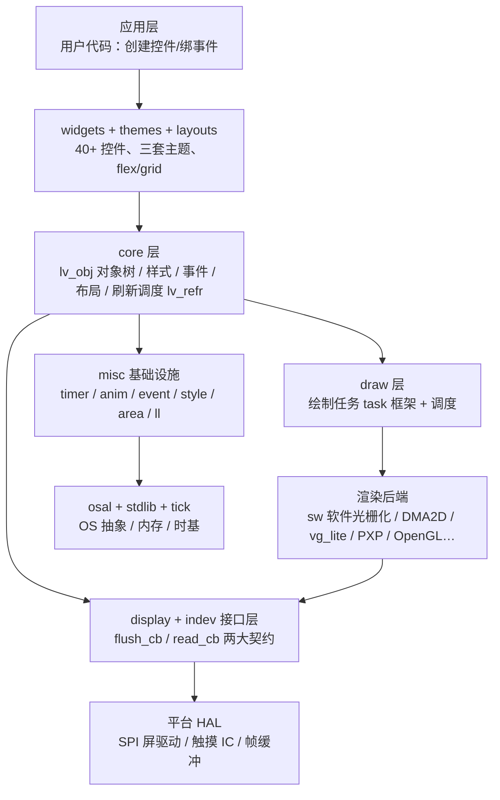
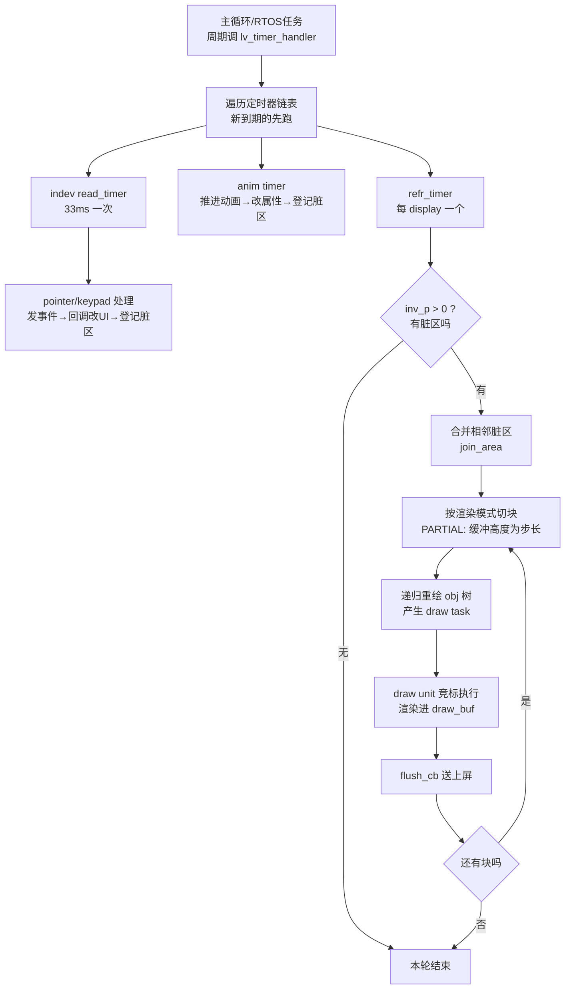

# LVGL 源码详解 00：总览与架构

> 涉及文件：
> - `lv_version.h` → 实际生成于 `include/lvgl/lv_version.h`（版本号）
> - `src/lv_init.c`（全局初始化/反初始化总装，541 行）
> - `src/core/lv_global.h`（全局状态单例）
> - `src/` 下各模块目录（core / display / indev / draw / misc / osal / stdlib / drivers / themes / widgets / font / tick / fs / image / layouts）
> - `lv_conf_template.h`（2640 行，全库配置模板）
> - `README.md`（官方最小移植示例）

---

## 1. 这是什么：一句话与版本坐标

LVGL（Light and Versatile Graphics Library）是一个**零外部依赖**的嵌入式图形库：
自带对象系统（C 语言的"类"）、样式引擎、软件渲染器、可选 GPU 后端、输入抽象、
动画/定时器框架。本仓库版本坐标（`include/lvgl/lv_version.h:9-12`）：

```c
#define LVGL_VERSION_MAJOR 10
#define LVGL_VERSION_MINOR 0
#define LVGL_VERSION_PATCH 0
#define LVGL_VERSION_INFO "dev"
```

即 **v10.0.0-dev**（v9 系 API 已大量重命名：`lv_disp_t` → `lv_display_t`、
`lv_disp_buf` → `lv_display_set_buffers`、`lv_obj_clear_flag` → `lv_obj_remove_flag` 等，
读 v8/v9 教程时注意对照）。

资源量级（README.md:49-50 官方口径）：典型 UI 约 100 KB RAM、200~300 KB Flash、
1/10 屏大小的渲染缓冲；裸机下限约 32 KB RAM + 128 KB Flash（README.md:68）。

## 2. 源码树地图（src/ 目录职责表）

| 目录 | 职责 | 关键文件 | 体量级 |
|---|---|---|---|
| `src/core/` | 对象系统 + 刷新调度 + 输入组 | `lv_obj.c`(2332)、`lv_refr.c`(1537)、`lv_obj_style.c`(1761)、`lv_obj_pos.c`(1769)、`lv_obj_event.c`(485)、`lv_obj_class.c`(243)、`lv_obj_tree.c`(866)、`lv_group.c`(577) | ~1 万行 |
| `src/display/` | 显示器抽象 | `lv_display.c`(1742) + private.h(216) | 2 千行 |
| `src/indev/` | 输入设备抽象、滚动、手势 | `lv_indev.c`(2053)、`lv_indev_scroll.c`(774)、`lv_indev_gesture.c`(1016)、`lv_gridnav.c` | 4 千行 |
| `src/draw/` | 绘制任务框架 + 各后端 | `lv_draw.c`(839) + `sw/`(软件后端)、`dma2d/`、`vg_lite/`、`nxp/`(pxp,g2d)、`renesas/`(dave2d)、`opengles/`、`sdl/`、`nanovg/`、`nema_gfx/` 等 | 万余行 |
| `src/misc/` | 定时器/动画/事件/样式/异步 + 数据结构 | `lv_timer.c`(426)、`lv_anim.c`(887)、`lv_event.c`(520)、`lv_style.c`(603)、`lv_async.c`(111)、`lv_area.c`(699)、`lv_ll.c`/`lv_array.c`/`lv_rb.c`/`lv_cache/` | ~5 千行 |
| `src/osal/` | OS 抽象层 | `lv_os.c`、`lv_freertos.c`、`lv_pthread.c`、`lv_sdl2.c`、`lv_cmsis_rtos2.c`、`lv_rtthread.c`、`lv_linux.c`、`lv_mqx.c`、`lv_os_none.c` | ~2 千行 |
| `src/stdlib/` | 内存/字符串/格式化抽象 | `lv_mem.c`(191)、`builtin/`、`clib/`、`micropython/`、`rtthread/` | ~1 千行 |
| `src/tick/` | 毫秒时基 | `lv_tick.c`(112) | 百行级 |
| `src/font/` | 字体引擎 + 内置字体 | `lv_font.c`(271)、montserrat 系列、`freetype/`、`tiny_ttf/`、`binfont_loader/` | 千行级 |
| `src/widgets/` | 40+ 控件 | `label/`、`arc/`、`chart/`、`table/`、`tabview/`、`roller/`…每控件一个目录 | 数万行 |
| `src/themes/` | 三套主题 | `default/`、`simple/`、`mono/` + `lv_theme.c` | 千行级 |
| `src/layouts/` | 布局引擎注册框架 | `lv_layout.c` + `flex/` + `grid/` | 千行级 |
| `src/fs/` | 文件系统抽象 | `lv_fs.c` + fatfs/littlefs/posix/stdio/win32/memfs 等适配 | 千行级 |
| `src/image/` | 图像解码器框架 | `lv_image_decoder.c` + png/jpeg/bmp/webp/svg 适配 | 千行级 |
| `src/drivers/` | 平台驱动（SDL/X11/Wayland/fbdev/evdev/Windows…） | 各平台一个目录 | 数千行 |
| `src/libs/` | 内嵌第三方库 | thorvg、freetype、lodepng、tjpgd、lz4、qrcode、gltf… | 第三方，不注释 |
| `src/others/` | 附加功能 | fragment、file_explorer、translation | 小 |
| `src/debugging/` | profiler/sysmon | 内置性能监控 | 小 |

> 全库只有一个"全局状态"结构 `lv_global_t`（`src/core/lv_global.h`），
> 定时器链表、显示器链表、绘制单元链表、样式刷新标志全部挂在它身上。
> 各 .c 文件顶部的 `#define state LV_GLOBAL_DEFAULT()->xxx_state` 就是访问它的惯用法。

## 3. 分层架构：五层职责



分层的关键设计决策：

1. **core 不直接画像素**。core 层只产生"绘制任务"（`lv_draw_task_t`），真正的光栅化在
   draw 层的"绘制单元"（`lv_draw_unit_t`）里做——软件单元、GPU 单元并存，按任务逐个竞标
   （`evaluate_cb` 打分）。详见 [03-draw层精读](03-draw层精读.md)。
2. **display 层只有 1742 行**。它不是驱动，只是驱动接口：`flush_cb`（把渲染好的像素送出去）
   和 `read_cb`（输入）两个回调契约是移植者唯一必须实现的东西。
3. **misc 是全局地基**。timer/anim/event/style 全部被 core 依赖，但 misc 不反向依赖 core
   （只依赖 lv_global），层次干净。
4. **OSAL 可选**。`LV_USE_OS = LV_OS_NONE` 时全库单线程零锁运行；开 OS 后才启用
   渲染线程、线程同步原语（`lv_thread_sync_*`）。

## 4. 启动时序：lv_init() 把 16 个子系统装配起来

`src/lv_init.c:158-404` 的 `lv_init()` 是全库唯一入口。装配顺序（真实行号）：

| 行号 | 调用 | 装配了什么 |
|---|---|---|
| 166-169 | 重复初始化保护 | `lv_initialized` 标志 |
| 174 | `LV_GLOBAL_INIT()` | `lv_global_t` 清零 + 链表初始化（lv_init.c:105-135：disp_ll、indev_ll、随机种子 0x1234ABCD） |
| 176 | `lv_mem_init()` | 内存池/堆 |
| 178 | `lv_draw_buf_init_handlers()` | 绘制缓冲拷贝/填充函数表 |
| 198 | `lv_os_init()` | OSAL（互斥量等，仅 LV_USE_OS 时有实体） |
| 200 | `lv_timer_core_init()` | 定时器链表 + 允许运行标志 |
| 202 | `lv_fs_init()` | 文件系统驱动链表 |
| 204 | `lv_layout_init()` | 布局引擎注册（flex/grid） |
| 206 | `lv_anim_core_init()` | 动画链表 + 动画定时器 |
| 208 | `lv_group_init()` | 输入组（编码器/键盘导航） |
| 217 | `lv_draw_init()` | 绘制单元链表 + 线程同步 |
| 219-221 | `lv_draw_sw_init()` | 软件绘制单元 + 渲染线程 |
| 223-269 | 各 GPU 后端 init | 按 `LV_USE_DRAW_*` 编译开关 |
| 271 | `lv_obj_style_init()` | 样式过渡链表 |
| 274 | `lv_refr_init()` | 刷新子系统（v10 里为空壳，状态都在 disp 里） |
| 280-281 | `lv_image_decoder_init()` | 图像解码链 + 内置 bin 解码器 |
| 287-293 | UTF-8 自检 | `"Á"` 必须是 `0xC3 0x81`，否则警告"非 ASCII 无法显示" |
| 295-306 | 字节序自检 | 与 `LV_BIG_ENDIAN_SYSTEM` 配置核对，不符直接断言 |
| 401 | `lv_initialized = true` | 完成 |

两个自检（287-306 行）值得记住：**源文件编码不是 UTF-8、或字节序宏配反了，
lv_init 一跑日志里立刻能看出来**——这是排"中文乱码/花屏"的第一步。

对应的 `lv_deinit()`（lv_init.c:406-537）按相反顺序拆卸：先删显示器与输入设备
（`lv_cleanup_devices`，137-146 行），再逐子系统 deinit。

## 5. 运行时模型：单线程 + 心跳

LVGL v10 的运行时是"**一切皆定时器**"：

| 定时器 | 周期（默认） | 干的事 | 定义处 |
|---|---|---|---|
| 每个 indev 的 read_timer | `LV_DEF_REFR_PERIOD`(33 ms) | 调 `read_cb` → 产生按下/释放事件 | lv_indev.c:111 |
| 全局动画 timer | 33 ms | 推进所有 `lv_anim_t` | lv_anim.c:67 |
| 每个 display 的 refr_timer | 33 ms | 脏区合并 → 渲染 → flush | lv_display.c:131 |
| 用户定时器 | 自定义 | 应用周期任务 | `lv_timer_create` |

用户侧唯一要做的是周期调用心跳：

```c
while(1) {
    lv_timer_handler();   /* 返回"距下次需要处理的毫秒数" */
    my_sleep_ms(5);
}
```

`lv_timer_handler()`（lv_timer.c:68-143）一次调用会把所有到期定时器各执行一遍，
返回值是"距离下一个定时器到期的时间"——用它做自适应 sleep 可省电（见
[06-定时器与任务模型](06-定时器与任务模型.md)）。

**线程规则**：LVGL API 不是线程安全的。多 RTOS 任务场景下的标准做法是——
只有一个任务碰 LVGL（其他任务用队列/observer 传数据过去），或者用 `lv_lock()/lv_unlock()`
包住临界段（`lv_timer_handler` 内部自己会 lv_lock，lv_timer.c:86/139）。

## 6. 一帧的旅程（数据流全景）

```mermaid
flowchart LR
    A["触摸/按键硬件"] -->|"raw x,y,状态"| B["indev read_cb<br/>用户实现"]
    B -->|"lv_indev_data_t"| C["indev_proc_press/release<br/>命中测试→控件事件"]
    C -->|"LV_EVENT_* / 冒泡"| D["应用事件回调<br/>改属性/样式/布局"]
    D -->|"lv_obj_invalidate"| E["inv_areas 脏区数组<br/>最多 32 块"]
    E -->|"refr_timer 到期"| F["lv_refr 脏区合并/切块"]
    F -->|"逐块"| G["obj 树递归<br/>生成 lv_draw_task_t"]
    G -->|"竞标 dispatch"| H["draw unit(s)<br/>sw 线程 / GPU"]
    H -->|"像素写入"| I["draw_buf 渲染缓冲<br/>PARTIAL 小块 / DIRECT 全屏"]
    I -->|"flush_cb"| J["显示驱动<br/>SPI DMA / 帧缓冲"]
    J -->|"flush_ready"| K["下一块/下一帧"]
```



读这张图对照源码的路径：

1. 输入侧：`src/indev/lv_indev.c`（read 契约、按下/释放/长按状态机）
2. 事件侧：`src/core/lv_obj_event.c`（`event_send_core` 冒泡）
3. 失效侧：`src/core/lv_refr.c:269-345`（`lv_inv_area` 脏区登记）
4. 渲染侧：`src/core/lv_refr.c:365-458`（`lv_display_refr_timer` 一帧总指挥）
5. 绘制侧：`src/draw/lv_draw.c`（任务竞标）+ `src/draw/sw/lv_draw_sw.c`（软件执行）
6. 上屏侧：`src/display/lv_display.c`（flush 握手）

## 7. 刷新任务的执行流（谁在什么时候跑）



注意 R3 的"按渲染模式切块"：PARTIAL 模式下每次只渲染缓冲装得下的行数
（`get_max_row`），渲染完立即 flush 再复用同一块小缓冲；DIRECT/FULL 模式
缓冲是全屏大小，一次渲染完。三种缓冲模式的取舍见
[04-显示驱动接口](04-显示驱动接口.md)。

## 8. 模块依赖速查（写移植代码时的查表）

| 你要做的 | 依赖的模块 | 最小配置项 |
|---|---|---|
| 点屏 | display + draw/sw | `LV_USE_DRAW_SW=1`、flush_cb |
| 触摸 | indev | read_cb |
| 中文显示 | font（外部字体） | lv_font_conv 生成 C 数组 |
| 图片显示 | image + fs | 对应解码器宏（lodepng/tjpgd…） |
| 动画 | misc/lv_anim | 默认开启 |
| 多任务 | osal | `LV_USE_OS=LV_OS_FREERTOS` 等 |
| GPU 加速 | draw/对应后端 | `LV_USE_DRAW_DMA2D` 等 + tile_cnt=1 |
| 性能监控 | debugging/sysmon | `LV_USE_PERF_MONITOR=1` |

## 9. 本系列文章导读

| 篇 | 主题 | 核心源文件 |
|---|---|---|
| [01-对象系统与事件](01-对象系统与事件.md) | lv_obj 类机制/生命周期/状态/事件冒泡 | core/lv_obj*.c |
| [02-渲染管线与刷新](02-渲染管线与刷新.md) | 脏区→渲染→上屏全流程 | core/lv_refr.c |
| [03-draw层精读](03-draw层精读.md) | 绘制任务/竞标/sw 后端/混合 | draw/* |
| [04-显示驱动接口](04-显示驱动接口.md) | display 抽象/flush 契约/缓冲模式 | display/lv_display.c |
| [05-输入设备与触控](05-输入设备与触控.md) | indev 契约/手势/滚动手感 | indev/* |
| [06-定时器与任务模型](06-定时器与任务模型.md) | timer/anim/async 三件套 | misc/lv_timer 等 |
| [07-移植与实战指南](07-移植与实战指南.md) | lv_conf.h 逐项/FreeRTOS/坑 | lv_conf_template.h |

KB 速查条目（同仓库知识库目录）：`lv_obj` / `lv_display` / `lv_refr` / `lv_draw_sw` /
`lv_timer` / `lv_event` / `lv_style` / `lv_conf_template`。

## 10. 陷阱与实测建议

1. **`lv_init()` 之前不要创建任何对象/定时器**——`lv_obj_class_create_obj` 需要
   display 已就位（lv_obj_class.c:60-65：没有显示器时创建 screen 直接返回 NULL 并打警告）。
2. **tick 必须先通**。`lv_timer_handler` 里有个保底检测：tick 恒为 0 时累计 100 次
   打警告 "It seems lv_tick_inc() is not called."（lv_timer.c:90-96）——看到这行日志
   说明时基没接好，所有动画/刷新都不会动。
3. **双屏 = 两个 display 对象**。`lv_display_create` 可调多次，每个 display 有独立的
   屏幕树、脏区数组、refr_timer；`lv_display_set_default` 决定 `lv_obj_create(NULL)` 挂到谁身上。
4. **配置先抄模板**。把 `lv_conf_template.h` 复制为 `lv_conf.h`、把第一处 `#if 0`
   改为 `#if 1`（README.md:198），逐项调整。逐项说明见 [07-移植与实战指南](07-移植与实战指南.md)。
5. **先跑模拟器再上板**。`src/drivers/sdl/` 提供完整 SDL 后端，PC 上能验证 80% 的逻辑，
   硬件问题（时序/DMA）再单独排查。
