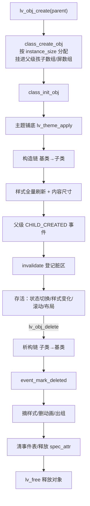
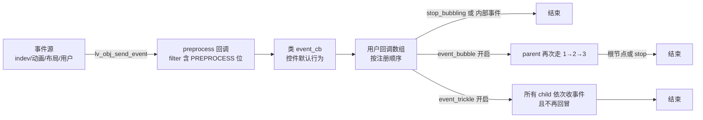
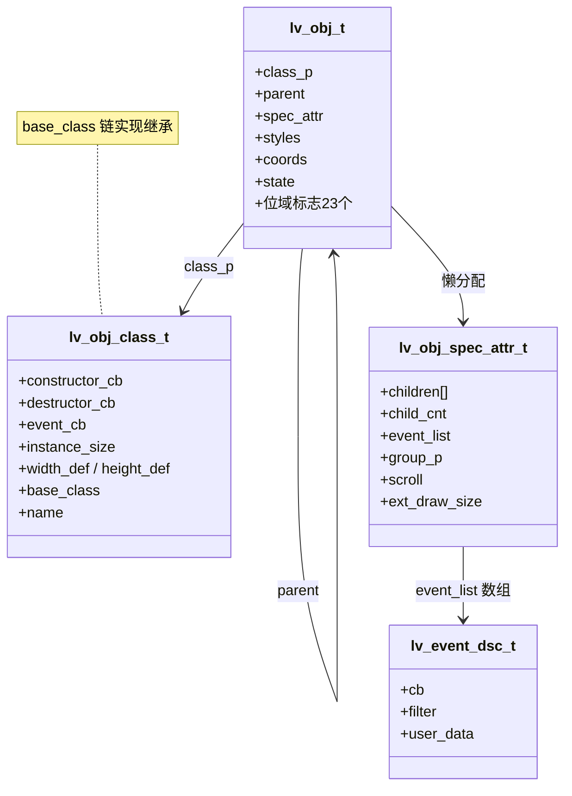

# LVGL 源码详解 01：对象系统与事件

> 涉及文件：
> - `src/core/lv_obj.c`（2332 行，一切控件之祖的实现）
> - `src/core/lv_obj_private.h`（201 行，`lv_obj_t` 结构真身）
> - `src/core/lv_obj_class.c`（243 行，类机制：创建/构造/析构）
> - `src/core/lv_obj_event.c`（485 行，事件分发/冒泡/滴灌）
> - `src/misc/lv_event.c`（520 行，事件存储与发送内核）
> - `include/lvgl/core/lv_obj.h`（公开 API 头）

> 配套速查：KB 条目 [lv_obj.md](../../../05-学习笔记与知识库/Knowledge-Base/lvgl/lv_obj.md)、
> [lv_event.md](../../../05-学习笔记与知识库/Knowledge-Base/lvgl/lv_event.md)

---

## 1. 世界观：一个 struct + 一张类表 = C 语言继承

LVGL 没有对象运行时，"对象"就是一个 POD 结构 `lv_obj_t`，"类"是一张
`lv_obj_class_t` 函数表。继承靠 `base_class` 指针链实现：

`lv_obj_class`（基类，lv_obj.c:358-370）:

```c
const lv_obj_class_t lv_obj_class = {
    .constructor_cb = lv_obj_constructor,
    .destructor_cb = lv_obj_destructor,
    .event_cb = lv_obj_event,
    .width_def = LV_DPI_DEF,
    .height_def = LV_DPI_DEF,
    .editable = LV_OBJ_CLASS_EDITABLE_FALSE,
    .group_def = LV_OBJ_CLASS_GROUP_DEF_FALSE,
    .instance_size = (sizeof(lv_obj_t)),
    .base_class = NULL,
    .name = "lv_obj",
    LV_PROPERTY_CLASS_FIELDS(obj, OBJ)
};
```

每个控件（button/label/arc…）都定义自己的 `lv_obj_class_t`：
`instance_size` 换成自己扩展结构的尺寸、`base_class` 指向父类、
`constructor_cb/destructor_cb/event_cb` 覆写父类行为。
例如 button 的实例结构是 `lv_obj_t` + 一点扩展，malloc 的大小由
`instance_size` 决定——**这就是 C 里的"多态对象"**。

### 1.1 lv_obj_t 真身（lv_obj_private.h:58-167）

```c
struct _lv_obj_t {
    const lv_obj_class_t * class_p;
    lv_obj_t * parent;
    lv_obj_spec_attr_t * spec_attr;
    lv_obj_style_t * styles;
#if LV_OBJ_STYLE_CACHE
    uint32_t style_main_prop_is_set;
    uint32_t style_other_prop_is_set;
#endif
    void * user_data;
    lv_area_t coords;
    uint32_t hidden : 1;
    uint32_t clickable : 1;
    /* ...共 23 个属性位域，见下方属性表... */
    uint16_t state;
    uint16_t layout_inv : 1;
    uint16_t readjust_scroll_after_layout : 1;
    uint16_t scr_layout_inv : 1;
    uint16_t skip_trans : 1;
    uint16_t style_cnt  : 6;
    uint16_t h_layout   : 1;
    uint16_t w_layout   : 1;
    uint16_t is_deleting : 1;
    uint16_t rendered : 1;
    uint16_t has_blur : 1;
};
```

内存账（32 位平台，`LV_USE_EXT_DATA=0`、`LV_OBJ_STYLE_CACHE=1`）：

| 成员 | 字节 | 说明 |
|---|---|---|
| class_p/parent/spec_attr/styles | 16 | 4 指针 |
| style 缓存 2×u32 | 8 | 位图：某属性有没有被设置过（优化样式解析） |
| user_data | 4 | |
| coords (lv_area_t) | 16 | x1,y1,x2,y2 四个 int32 |
| 属性位域 u32 | 4 | 23 个 1bit 标志 |
| state 等 u16 组 | 4 | state(16b) + 11 个 1bit |
| **合计** | **52 B** | 不含 spec_attr/styles 指向的堆内存 |

懒分配设计：`spec_attr`（孩子数组、事件表、滚动偏移、分组）和 `styles`
（样式数组）**只有用到才 malloc**——一个"裸"lv_obj 只花 52 字节。
`spec_attr` 内容（lv_obj_private.h:32-55）：`children` 指针数组、`child_cnt`、
`event_list`、`scroll`（x/y 偏移）、`group_p`、`ext_click_pad`、`ext_draw_size`、
`scrollbar_mode`/`scroll_snap_x/y`/`scroll_dir`/`layer_type` 位域。

### 1.2 属性位域一览（行为开关全在这）

| 位 | 默认 | 作用 |
|---|---|---|
| hidden | 0 | 隐藏（完全跳过绘制与命中） |
| clickable | 1 | 可被输入设备点击 |
| click_focusable | 1 | 点击时抢焦点 |
| checkable | 0 | 点击切换 CHECKED 状态 |
| scrollable | 1 | 内容超出时可滚动 |
| scroll_elastic | 1 | 弹性过界回弹 |
| scroll_momentum | 1 | 惯性甩动 |
| scroll_one | 0 | 一次只滚到相邻 snap 子项 |
| scroll_chain_hor/ver | 有父时 1 | 滚到头后把滚动传给父级 |
| press_lock | 有父时 1 | 按住时滑动出对象不丢按下状态 |
| event_bubble | 0 | 事件冒泡给父级 |
| gesture_bubble | 有父时 1 | 手势冒泡 |
| event_trickle / state_trickle | 0 | 事件/状态下发给所有孩子 |
| ignore_layout / floating | 0 | 不参与 flex/grid 布局 / 不随父滚动 |
| adv_hittest | 0 | 精确命中测试（发给 HIT_TEST 事件由回调决定） |
| radio_button | 0 | 单选互斥 |

构造函数里的默认值（lv_obj.c:1505-1518）：

```c
    /*Set attributes*/
    obj->clickable = 1;
    obj->snappable = 1;
    obj->click_focusable = 1;
    obj->scrollable = 1;
    obj->scroll_elastic = 1;
    obj->scroll_momentum = 1;
    obj->scroll_with_arrow = 1;
    if(parent) {
        obj->press_lock = 1;
        obj->scroll_chain_hor = 1;
        obj->scroll_chain_ver = 1;
        obj->gesture_bubble = 1;
    }
```

## 2. 生命周期：创建 → 构造 → 生活 → 析构

### 2.1 创建流水线（lv_obj_class.c）

`lv_obj_create(parent)`（lv_obj.c:380-393）只有两步：

```c
lv_obj_t * lv_obj_create(lv_obj_t * parent)
{
    lv_obj_t * obj = lv_obj_class_create_obj(MY_CLASS, parent);
    if(obj == NULL) return NULL;
    lv_obj_class_init_obj(obj);
    return obj;
}
```

第一步 `lv_obj_class_create_obj`（lv_obj_class.c:45-105）——**分配 + 挂树**：

```c
    uint32_t s = get_instance_size(class_p);
    lv_obj_t * obj = lv_malloc_zeroed(s);          /* :51 按类大小清零分配 */
    obj->class_p = class_p;
    obj->parent = parent;

    /*Create a screen*/
    if(parent == NULL) {                            /* :58 parent==NULL 就是屏 */
        lv_display_t * disp = lv_display_get_default();
        if(!disp) {
            LV_LOG_WARN("No display created yet. No place to assign the new screen");
            lv_free(obj);
            return NULL;                            /* :62-64 没屏直接失败 */
        }
        /* 追加到 disp->screens 数组，coords 置为全屏 */   /* :71-87 */
    }
    /*Create a normal object*/
    else {
        LV_CHECK_OBJ(parent, MY_CLASS, return NULL);
        if(!lv_obj_allocate_spec_attr(parent)) {    /* :94 父级懒分配 spec_attr */
            lv_free(obj);
            return NULL;
        }
        if(lv_obj_add_child(parent, obj) != LV_RESULT_OK) {  /* :98 挂进孩子数组 */
            lv_free(obj);
            return NULL;
        }
    }
```

**关键认知**：`parent == NULL` 的对象是 screen（屏幕），不挂树，而是登记进
`disp->screens[]` 数组、坐标直接铺满屏幕（lv_obj_class.c:84-87）。
screen 之间用 `lv_screen_load()`/`lv_screen_load_anim()` 切换。

第二步 `lv_obj_class_init_obj`（lv_obj_class.c:107-137）——**初始化 + 通知**：

```c
    lv_obj_mark_layout_as_dirty(obj);
    lv_obj_enable_style_refresh(false);        /* :112 关样式刷新 */

    lv_theme_apply(obj);                       /* :114 主题先铺底 */
    lv_obj_construct(obj->class_p, obj);       /* :115 类构造链 */

    lv_obj_enable_style_refresh(true);
    lv_obj_refresh_style(obj, LV_PART_ANY, LV_STYLE_PROP_ANY);  /* :118 全量样式刷新 */

    lv_obj_refresh_self_size(obj);             /* :120 计算内容尺寸 */

    lv_group_t * def_group = lv_group_get_default();
    if(def_group && lv_obj_is_group_def(obj)) {
        lv_group_add_obj(def_group, obj);      /* :122-125 默认输入组收编 */
    }

    lv_obj_t * parent = lv_obj_get_parent(obj);
    if(parent) {
        lv_obj_send_event(parent, LV_EVENT_CHILD_CHANGED, obj);   /* :131 */
        lv_obj_send_event(parent, LV_EVENT_CHILD_CREATED, obj);   /* :132 */
        lv_obj_invalidate(obj);                /* :135 首次登记脏区 */
    }
```

顺序是刻意安排的：**主题 → 构造函数 → 样式全刷 → 尺寸 → 分组 → 通知父级 → 脏区**。
构造期间关掉样式刷新（112 行）避免每条 set_style 都触发一次全树刷新——
这是初始化路径最大的性能优化。

### 2.2 构造链：先父类后子类

`lv_obj_construct`（lv_obj_class.c:204-233）递归实现：

```c
    if(obj->class_p->base_class) {
        const lv_obj_class_t * original_class_p = obj->class_p;
        /*Don't let the descendant methods run during constructing the ancestor type*/
        obj->class_p = obj->class_p->base_class;   /* :223 临时降级为基类 */
        lv_obj_construct(class_p, obj);            /* :226 先构造基类 */
        obj->class_p = original_class_p;           /* :229 恢复 */
    }
    if(obj->class_p->constructor_cb) obj->class_p->constructor_cb(class_p, obj);  /* :232 */
```

即 button 的构造顺序是：lv_obj 构造（属性默认值/初始坐标）→ lv_button 构造。
`obj->class_p` 临时切换保证构造基类阶段不会误调用子类的覆写方法。
析构（`lv_obj_destruct`，lv_obj_class.c:139-160）正好相反：**先子类析构、后基类析构**。

### 2.3 删除：lv_obj_delete 的清理清单

析构函数 lv_obj_destructor（lv_obj.c:1527-1574）做的事，按序：

```c
    lv_event_mark_deleted(obj);                     /* :1533 正在发送中的事件标记失效 */
    lv_obj_enable_style_refresh(false);
    lv_obj_remove_style_all(obj);                   /* :1537 摘样式（不触发刷新） */
    lv_obj_enable_style_refresh(true);

    lv_anim_delete(obj, NULL);                      /* :1541 删掉所有作用于它的动画 */

    lv_group_t * group = lv_obj_get_group(obj);
    if(group) lv_group_remove_obj(obj);             /* :1544-1545 出组 */

    if(obj->spec_attr) {
        if(obj->spec_attr->children) {
            lv_free(obj->spec_attr->children);      /* :1549 孩子数组此时已空 */
            obj->spec_attr->children = NULL;
        }
        lv_event_remove_all(&obj->spec_attr->event_list);  /* :1553 事件回调全摘 */
        ...
        lv_free(obj->spec_attr);                    /* :1567 */
    }
```

删除对象前会递归删除其子树（lv_obj_tree.c 的 `lv_obj_delete`），然后才走到
这里。`lv_event_mark_deleted`（lv_event.c:341-349）沿全局事件栈扫描，
把 target 是该对象的事件打上 `deleted` 标记——发送循环里
`if(e->deleted) break`（lv_event.c:136-139）就地终止，防 use-after-free。

## 3. 状态机与样式过渡

### 3.1 状态集合与切换

状态枚举（DEFAULT/CHECKED/DISABLED/FOCUSED/PRESSED/HOVERED/FOCUS_KEYPAD/EDITED/USER_1..4）。
`lv_obj_set_state` → `update_obj_state`（lv_obj.c:2010-2068）：

```c
static void update_obj_state(lv_obj_t * obj, lv_state_t new_state)
{
    if(obj->state == new_state) return;

    lv_state_t prev_state = obj->state;

    lv_part_t changed_part = LV_PART_ANY;
    lv_style_state_cmp_t cmp_res = lv_obj_style_state_compare(obj, prev_state, new_state, &changed_part);
    /*If there is no difference in styles there is nothing else to do*/
    if(cmp_res == LV_STYLE_STATE_CMP_SAME) {              /* :2022 状态变了但样式没变 */
        obj->state = new_state;
        lv_obj_send_event(obj, LV_EVENT_STATE_CHANGED, &prev_state);
        return;
    }

    /*Invalidate the object in their current state*/
    lv_obj_invalidate(obj);                               /* :2029 先用旧状态记脏区 */

    obj->state = new_state;
    lv_obj_update_layer_type(obj);
    lv_obj_update_blur_status(obj);

    /*Skip transitions if the widget is not rendered yet. */
    if(!obj->rendered) {                                  /* :2036 首次渲染前跳过过渡动画 */
        lv_obj_invalidate(obj);
        if(cmp_res == LV_STYLE_STATE_CMP_DIFF_DRAW_PAD) {
            lv_obj_refresh_ext_draw_size(obj);
        }
        lv_obj_send_event(obj, LV_EVENT_STATE_CHANGED, &prev_state);
        return;
    }

    obj_transition_states(obj, prev_state, new_state);    /* :2046 生成过渡动画 */
    /* 按 cmp_res 分级刷新：REDRAW / LAYOUT / DRAW_PAD 三档 */  /* :2048-2065 */
    lv_obj_send_event(obj, LV_EVENT_STATE_CHANGED, &prev_state);  /* :2067 */
}
```

设计要点：

1. **旧状态先失效**（2029 行）——旧外观要被重画消失；新状态在样式刷新里再失效一次。
   两次失效覆盖"状态切换前后外观都变了"的区域。
2. **`rendered` 位**（lv_obj_private.h:159-161）在第一次真正绘制时置 1
   （lv_refr.c:112 `obj->rendered = 1`），控件"出生即选中"这类情况就不会播放
   一段突兀的过渡动画。
3. **四级差异分级**：`SAME`（什么都不做）→ `DIFF_REDRAW`（重画）→
   `DIFF_LAYOUT`（重排）→ `DIFF_DRAW_PAD`（只需扩 ext_draw_size）。
   状态比较由 `lv_obj_style_state_compare` 完成，避免"按一下按钮全屏重排"。

### 3.2 过渡动画的收集

`obj_transition_states`（lv_obj.c:2070-2122）扫描所有样式里带
`LV_STYLE_TRANSITION` 属性的项，把要过渡的属性收集到最多
`STYLE_TRANSITION_MAX = 32`（lv_obj.c:38）的数组里，然后逐个调
`lv_obj_style_create_transition`（lv_obj_style.c:519）——本质是为每个过渡属性
创建一个 `lv_anim_t`，动画值写进对象上的临时过渡样式（`is_trans` 标记），
动画完成后摘除。这就是"按下按钮背景色平滑变化"的全部实现。

## 4. 事件系统：发送、冒泡、滴灌

### 4.1 事件是怎么存的

每个对象的 `spec_attr->event_list` 是一个 `lv_event_dsc_t` 指针数组
（lv_event.c:154-189 的 `lv_event_add` 逐条 push）：

| 字段 | 含义 |
|---|---|
| cb | 回调函数 |
| filter | 事件码过滤（可叠加 `LV_EVENT_PREPROCESS` 位） |
| user_data | 传回回调的私有数据 |

发送时按"先 preprocess 回调 → 基类 event_cb → 普通回调"的顺序（见 4.3）。
`filter == LV_EVENT_ALL` 时任何事件都触发。

### 4.2 全局事件栈防 use-after-free

`lv_event_push/lv_event_pop`（lv_event.c:64-77）维护一条事件链：

```c
void lv_event_push(lv_event_t * e)
{
    /*Build a simple linked list from the objects used in the events
     *It's important to know if this object was deleted by a nested event
     *called from this `event_cb`.*/
    e->prev = event_head;
    event_head = e;
}
```

事件嵌套（回调里又发事件）时栈会叠多层；任何一层里对象被删，
`lv_event_mark_deleted` 会把栈上所有 target 匹配的事件标记 `deleted=1`，
外层循环立刻中断。另外 `lv_event_send`（lv_event.c:102-152）在遍历回调数组前
把数组头备份（112 行 `lv_array_t back_array_head = list->array;`），
并用 `is_traversing` 标志 + "标记删除、事后清理"（`LV_EVENT_MARKED_DELETING`
位，lv_event.c:503-511）机制保证"回调里删自己的回调"不会破坏正在遍历的数组。

### 4.3 分发核心 event_send_core（lv_obj_event.c:350-401）

```c
static lv_result_t event_send_core(lv_event_t * e)
{
    lv_indev_t * indev_act = lv_indev_active();
    if(indev_act) {
        if(e->stop_processing) return LV_RESULT_OK;
        if(e->deleted) return LV_RESULT_INVALID;
    }

    lv_obj_t * target = e->current_target;
    lv_result_t res = LV_RESULT_OK;
    lv_event_list_t * list = target->spec_attr ?  &target->spec_attr->event_list : NULL;

    res = lv_event_send(list, e, true);          /* :364 1) preprocess 回调 */
    if(res != LV_RESULT_OK || e->stop_processing) return res;

    res = lv_obj_event_base(NULL, e);            /* :367 2) 类的 event_cb（控件默认行为） */
    if(res != LV_RESULT_OK || e->stop_processing) return res;

    res = lv_event_send(list, e, false);         /* :370 3) 用户普通回调 */
    if(res != LV_RESULT_OK || e->stop_processing) return res;

    lv_obj_t * parent = lv_obj_get_parent(e->current_target);
    if(parent && event_is_bubbled(e)) {          /* :374 4) 向父级冒泡 */
        e->current_target = parent;
        res = event_send_core(e);
    }
    ...
    /*Trickle down to children if enabled*/
    if(event_is_trickled(e)) {                   /* :381 5) 向孩子滴灌 */
        ...
        e->stop_bubbling = 1;                    /* :385 滴灌的孩子不再冒回来 */
        for(uint32_t i = 0; i < child_count && ...; i++) {
            lv_obj_t * child = lv_obj_get_child(target, i);
            e->current_target = child;
            res = event_send_core(e);
        }
    }
    return res;
}
```

五步顺序：**预处理回调 → 类默认处理 → 用户回调 → 冒泡 → 滴灌**。
注意每一步之间都检查 `stop_processing`（`lv_event_stop_processing`）——
用户回调里可以随时叫停整条链。

### 4.4 哪些事件会冒泡（event_is_bubbled，lv_obj_event.c:403-442）

```c
static bool event_is_bubbled(lv_event_t * e)
{
    if(e->stop_bubbling) return false;

    /*Event codes that always bubble*/
    switch(e->code) {
        case LV_EVENT_CHILD_CREATED:
        case LV_EVENT_CHILD_DELETED:
            return true;                          /* 永远冒泡 */
        default:
            break;
    }

    /*Check other codes only if bubbling is enabled*/
    if(lv_obj_is_event_bubble(e->current_target) == false) return false;

    switch(e->code) {
        case LV_EVENT_HIT_TEST:
        case LV_EVENT_COVER_CHECK:
        case LV_EVENT_REFR_EXT_DRAW_SIZE:
        case LV_EVENT_DRAW_MAIN_BEGIN:
        /* ...绘制类、CHILD_CHANGED、SIZE_CHANGED、STYLE_CHANGED、GET_SELF_SIZE... */
            return false;                         /* 开了冒泡也不许冒的内部事件 */
        default:
            return true;                          /* 其余都冒 */
    }
}
```

三档：**CHILD_CREATED/DELETED 永远冒**；绘制/布局类内部事件**永不冒**；
其余事件需要对象开了 `LV_OBJ_FLAG_EVENT_BUBBLE` 才冒。滴灌（`event_is_trickled`，
444-474 行）规则镜像对称。

这套机制是"列表项点击 → 列表容器统一处理"这类模式的基础：
子项开 `event_bubble`，容器上挂一个 CLICKED 回调即可。

## 5. 事件与控件数据的读取

回调里拿上下文的标准姿势（lv_obj_event.c 的封装）：

| API | 返回 | 行号 |
|---|---|---|
| `lv_event_get_target_obj(e)` | 最初触发事件的控件（original_target） | 196-200 |
| `lv_event_get_current_target_obj(e)` | 当前正在处理事件的控件（冒泡后=父级） | 190-194 |
| `lv_event_get_code(e)` | 事件码（剥掉 PREPROCESS 位） | lv_event.c:287-291 |
| `lv_event_get_user_data(e)` | 注册回调时的 user_data | lv_event.c:299-303 |
| `lv_event_get_indev(e)` | 触发事件的输入设备（仅输入类事件） | 202-223 |
| `lv_event_get_key(e)` / `lv_event_get_rotary_diff(e)` | 键值 / 旋转增量 | 250-268 |
| `lv_event_get_draw_task(e)` | DRAW_TASK_ADDED 事件的任务 | 327-334 |
| `lv_event_get_prev_state(e)` | STATE_CHANGED 的旧状态 | 336-344 |

## 6. 生命周期与事件全景图





## 7. 类关系图



## 8. 陷阱与实测建议

1. **回调里删对象是允许的**，但要理解后果：发送循环会在下一轮检查 `e->deleted`
   终止；**回调里删的是"别的对象"时不会终止当前事件**，只是那个对象的事件被跳过。
2. **`lv_obj_send_event` 手动发的自定义事件不会自动冒泡**——除非接收对象开了
   `event_bubble`。想让"容器统一收事件"，给子控件开 bubble，事件注册在容器上。
3. **CHILD_CHANGED 在孩子增删/尺寸变化时都会发**（lv_obj_class.c:131 与布局系统），
   高频布局容器里别在这个事件里做重活。
4. **状态位是 u16，USER_1..4 给应用层用**——跨模块传递"选中态"之类自定义状态
   别抢 CHECKED/PRESSED。
5. **`lv_obj_delete` 删除时动画会被一并删掉**（lv_obj.c:1541），所以"页面销毁时
   动画回调访问野指针"的问题天然规避；但**`completed_cb` 里访问其他对象**仍需
   自证存活（用 observer 或先判断）。
6. **事件数组容量没有上限**但每条是 malloc 的 `lv_event_dsc_t`（lv_event.c:159），
   给同一个控件挂几十个回调时注意堆用量；`lv_obj_remove_event_cb` 可按回调指针批量摘除。
