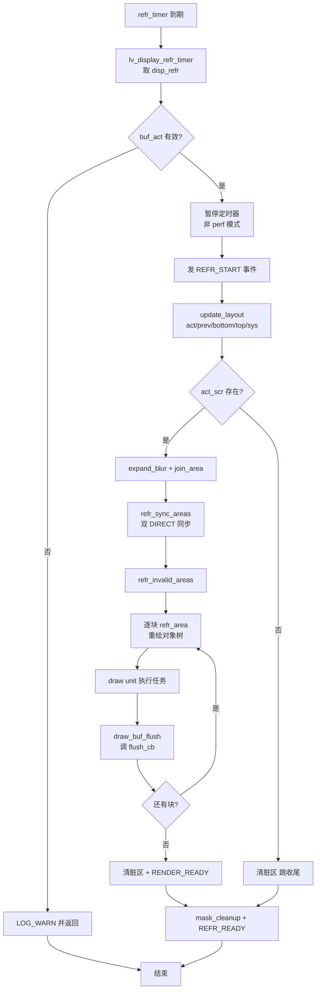
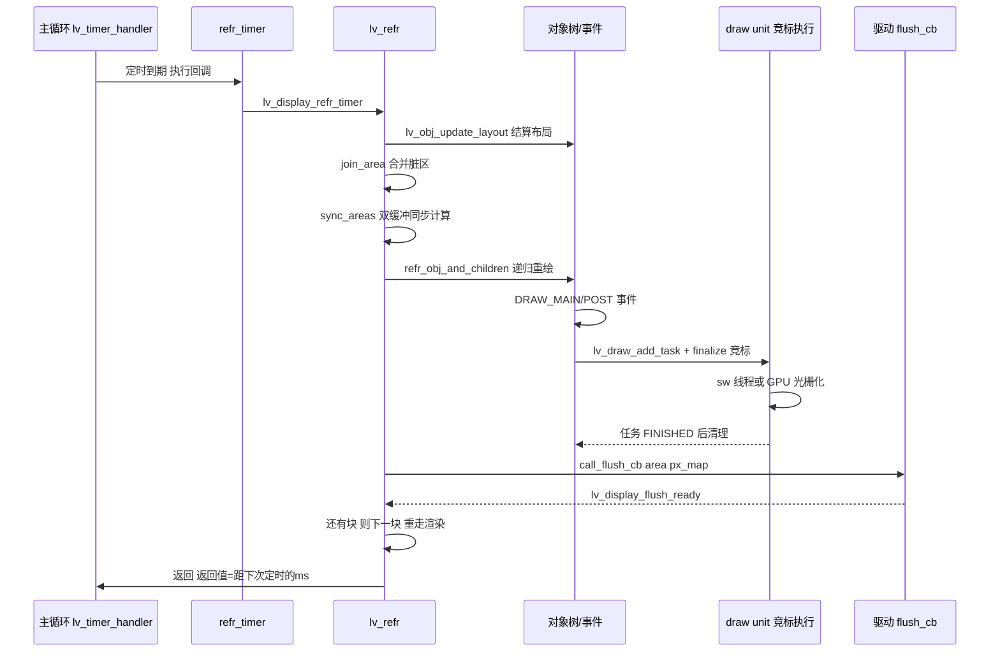
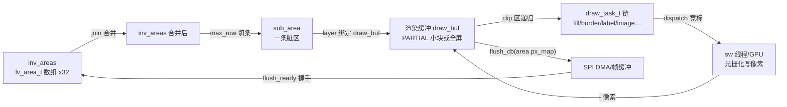

# LVGL 源码详解 02：渲染管线与刷新

> 涉及文件：
> - `src/core/lv_refr.c`（1537 行，刷新系统全流程）
> - `src/display/lv_display_private.h`（216 行，脏区数组/缓冲字段）
> - `src/display/lv_display.c`（1742 行，refr_timer 的宿主）
> - `src/draw/lv_draw.c`（839 行，绘制任务调度，详见 03 篇）
> - `src/core/lv_obj.c` 的 `lv_obj_draw`/绘制事件（1576 行起）

> 配套速查：KB 条目 [lv_refr.md](../../../05-学习笔记与知识库/Knowledge-Base/lvgl/lv_refr.md)

---

## 1. 全景：从"这个控件变了"到"屏幕亮了"

渲染管线的三段式：

1. **失效（invalidate）**：任何会改变外观的操作调 `lv_obj_invalidate`，
   把对象外接矩形登记进 display 的脏区数组。
2. **刷新（refresh）**：display 自带的 refr_timer 到期后，合并脏区 →
   逐块把对象树重画进渲染缓冲（此过程产生 draw task，由绘制单元执行）。
3. **上屏（flush）**：渲染好的缓冲经 `flush_cb` 交给驱动（SPI DMA / 帧缓冲），
   `lv_display_flush_ready` 握手后渲染下一块。

LVGL 的核心效率思想：**只重画变化的部分**。理解了脏区的登记、合并、切块，
就掌握了"刷新慢"类问题的排查方法。

## 2. 失效：lv_inv_area 的登记规则（lv_refr.c:269-345）

```c
lv_result_t lv_inv_area(lv_display_t * disp, const lv_area_t * area_p)
{
    if(disp == NULL) {
        disp = lv_display_get_default();
    }
    if(!disp) return LV_RESULT_INVALID;
    if(!lv_display_is_invalidation_enabled(disp)) return LV_RESULT_INVALID;
    /* 单线程约束的断言：渲染进行中禁止失效 */
    LV_ASSERT_MSG(!disp->rendering_in_progress, "Invalidate area is not allowed during rendering.");

    /*Clear the invalidate buffer if the parameter is NULL*/
    if(area_p == NULL) {
        disp->inv_p = 0;
        return LV_RESULT_OK;
    }

    lv_area_t scr_area;                                 /* 与屏幕求交 */
    ...
    suc = lv_area_intersect(&com_area, area_p, &scr_area);
    if(suc == false)  return LV_RESULT_INVALID;         /* :307 完全在屏外，丢弃 */

    if(disp->color_format == LV_COLOR_FORMAT_I1) {
        /*Make sure that the X coordinates start and end on byte boundary.*/
        com_area.x1 &= ~0x7;                            /* :313 I1 格式按字节对齐 */
        com_area.x2 |= 0x7;
    }

    /*If there were at least 1 invalid area in full refresh mode, redraw the whole screen*/
    if(disp->render_mode == LV_DISPLAY_RENDER_MODE_FULL) {
        disp->inv_areas[0] = scr_area;
        disp->inv_p = 1;                                /* :318 FULL 模式永远整屏 */
        lv_display_send_event(disp, LV_EVENT_REFR_REQUEST, NULL);
        return LV_RESULT_OK;
    }

    lv_result_t res = lv_display_send_event(disp, LV_EVENT_INVALIDATE_AREA, &com_area);
    if(res != LV_RESULT_OK) return LV_RESULT_INVALID;   /* :324 允许驱动微调脏区 */

    /*Save only if this area is not in one of the saved areas*/
    uint16_t i;
    for(i = 0; i < disp->inv_p; i++) {
        if(lv_area_is_in(&com_area, &disp->inv_areas[i], 0) != false) return LV_RESULT_OK;  /* :330 去重 */
    }

    /*Save the area*/
    lv_area_t * tmp_area_p = &com_area;
    if(disp->inv_p >= LV_INV_BUF_SIZE) {                /* :335 缓冲满 → 整屏重画 */
        disp->inv_p = 0;
        tmp_area_p = &scr_area;
    }
    disp->inv_areas[disp->inv_p] = *tmp_area_p;
    disp->inv_p++;

    lv_display_send_event(disp, LV_EVENT_REFR_REQUEST, NULL);
    return LV_RESULT_OK;
}
```

要点表：

| 规则 | 行号 | 后果 |
|---|---|---|
| 脏区数组大小 `LV_INV_BUF_SIZE = 32` | lv_display_private.h:30 | 最多缓存 32 块 |
| 溢出处理：清空 + 整屏 | lv_refr.c:335-338 | 一次改 33+ 个控件 = 整屏重画 |
| FULL 渲染模式恒整屏 | lv_refr.c:317-322 | |
| `rendering_in_progress` 期间禁止失效 | lv_refr.c:289 | 渲染中断言触发；跨线程改 UI 或 DRAW 事件里改样式都会踩 |
| I1（单色）格式 x 坐标对齐到字节 | lv_refr.c:309-314 | 单色屏脏区 x 量化到 8 像素 |
| `LV_EVENT_INVALIDATE_AREA` 可改写脏区 | lv_refr.c:324 | 驱动级 hook |

**失效计算包含 ext_draw_size**：`lv_obj_invalidate` 用的是
`对象坐标 + ext_draw_size`（阴影、外发光画在控件矩形外，漏记会留残影）。

## 3. 刷新总指挥：lv_display_refr_timer（lv_refr.c:365-458）

每个 display 在 `lv_display_create` 时就挂了刷新定时器
（lv_display.c:131，周期 `LV_DEF_REFR_PERIOD` 默认 33 ms，lv_conf_template.h:153）。
它到期执行：

```c
void lv_display_refr_timer(lv_timer_t * timer)
{
    if(timer) {
        disp_refr = timer->user_data;                   /* :371 定时器知道自己是哪个屏 */
    }
    ...
    lv_draw_buf_t * buf_act = disp_refr->buf_act;
    if(!(buf_act && buf_act->data && buf_act->data_size)) {
        LV_LOG_WARN("No draw buffer");                  /* :385 没配缓冲直接退出 */
        ...
    }
    /* Ensure the timer does not run again automatically. */
#if !LV_USE_PERF_MONITOR
    if(timer) lv_timer_pause(timer);                    /* :396 自暂停：渲染期间不许再来 */
#endif
    lv_result_t res = lv_display_send_event(disp_refr, LV_EVENT_REFR_START, NULL);
    ...
    /*Refresh the screen's layout if required*/
    if(disp_refr->act_scr) lv_obj_update_layout(disp_refr->act_scr);     /* :408 */
    if(disp_refr->prev_scr) lv_obj_update_layout(disp_refr->prev_scr);
    lv_obj_update_layout(disp_refr->bottom_layer);
    lv_obj_update_layout(disp_refr->top_layer);
    lv_obj_update_layout(disp_refr->sys_layer);        /* :413 五棵树布局先结算 */
    ...
    /*Expand the invalidated areas for blur objects before joining them*/
    lv_obj_invalidate_expand_blur(disp_refr);          /* :424 模糊对象扩脏区 */
    lv_refr_join_area();                               /* :425 合并 */
    refr_sync_areas();                                 /* :426 双缓冲同步区 */
    refr_invalid_areas();                              /* :427 渲染+上屏 */

    if(disp_refr->inv_p == 0) goto refr_finish;
    /*In double buffered direct mode or if sync callback is set, save the updated areas.*/
    if((lv_display_is_double_buffered(disp_refr) && disp_refr->render_mode == LV_DISPLAY_RENDER_MODE_DIRECT) ||
       disp_refr->sync_cb) {
        uint32_t i;
        for(i = 0; i < disp_refr->inv_p; i++) {
            if(disp_refr->inv_area_joined[i]) continue;
            lv_area_t * sync_area = lv_ll_ins_tail(&disp_refr->sync_areas);  /* :439 记录要同步的区域 */
            *sync_area = disp_refr->inv_areas[i];
        }
    }

    lv_memzero(disp_refr->inv_areas, sizeof(disp_refr->inv_areas));
    lv_memzero(disp_refr->inv_area_joined, sizeof(disp_refr->inv_area_joined));  /* :444-445 清空脏区 */
    disp_refr->inv_p = 0;
refr_finish:
#if LV_DRAW_SW_COMPLEX == 1
    lv_draw_sw_mask_cleanup();                         /* :451 释放 mask 缓存 */
#endif
    lv_display_send_event(disp_refr, LV_EVENT_REFR_READY, NULL);
}
```

流程解读：

1. **布局先行**（408-413 行）：`lv_obj_update_layout` 把标记 dirty 的布局全部结算，
   保证后面画的是最终坐标。布局是"拉"模型——绘制前才真正重排。
2. **自暂停**（396 行）：一次刷新只跑一轮。渲染过程中新失效的区域留给下一轮。
   开着 `LV_USE_PERF_MONITOR` 时不暂停（FPS 统计需要周期）。
3. **五个显示树**：act_scr（活动屏）、prev_scr（切屏动画中的旧屏）、
   bottom/top/sys 三层（lv_display.c:162-165 创建，见 04 篇）全部参与布局结算。
4. 脏区数组用完即清（444-446 行），`LV_EVENT_REFR_READY` 通知驱动。

## 4. 脏区合并：lv_refr_join_area（lv_refr.c:634-668）

```c
static void lv_refr_join_area(void)
{
    uint32_t join_from;
    uint32_t join_in;
    lv_area_t joined_area;
    for(join_in = 0; join_in < disp_refr->inv_p; join_in++) {
        if(disp_refr->inv_area_joined[join_in] != 0) continue;
        /*Check all areas to join them in 'join_in'*/
        for(join_from = 0; join_from < disp_refr->inv_p; join_from++) {
            if(disp_refr->inv_area_joined[join_from] != 0 || join_in == join_from) continue;

            /*Check if the areas are on each other*/
            if(lv_area_is_on(&disp_refr->inv_areas[join_in], &disp_refr->inv_areas[join_from]) == false) continue;

            lv_area_join(&joined_area, &disp_refr->inv_areas[join_in], &disp_refr->inv_areas[join_from]);

            /*Join two area only if the joined area size is smaller*/
            if(lv_area_get_size(&joined_area) < (lv_area_get_size(&disp_refr->inv_areas[join_in]) +
                                                 lv_area_get_size(&disp_refr->inv_areas[join_from]))) {
                disp_refr->inv_areas[join_in] = joined_area;
                disp_refr->inv_area_joined[join_from] = 1;
            }
        }
    }
}
```

**贪心合并**：任意两块相交（`lv_area_is_on`）就试合并，且**只有合并后面积
小于两块面积之和才真正合并**——把两个相距 1px 的窄条并成一个大方块反而
多画一堆没变的像素，这种合并被拒绝。复杂度 O(n²)，n≤32，开销可忽略。
合并掉的块标记 `inv_area_joined=1`，后续渲染跳过。

## 5. 分块渲染：refr_invalid_areas → refr_area（lv_refr.c:792-990）

```c
static void refr_invalid_areas(void)
{
    if(disp_refr->inv_p == 0) return;
    /*Notify the display driven rendering has started*/
    lv_display_send_event(disp_refr, LV_EVENT_RENDER_START, NULL);    /* :798 */
    ...
    for(i = 0; i < (int32_t)disp_refr->inv_p; i++) {
        if(disp_refr->inv_area_joined[i]) continue;                   /* :816 被合并的跳过 */

        if(i == last_i) disp_refr->last_area = 1;                     /* :818 通知 flush_cb 最后一区 */
        disp_refr->last_part = 0;

        lv_area_t inv_a = disp_refr->inv_areas[i];
        if(disp_refr->render_mode == LV_DISPLAY_RENDER_MODE_PARTIAL) {
            /*Calculate the max row num*/
            int32_t w = lv_area_get_width(&inv_a);
            int32_t h = lv_area_get_height(&inv_a);
            int32_t max_row = get_max_row(disp_refr, w, h);           /* :827 缓冲能装几行 */

            int32_t row;
            int32_t row_last = 0;
            lv_area_t sub_area;
            sub_area.x1 = inv_a.x1;
            sub_area.x2 = inv_a.x2;
            int32_t y_off = 0;
            for(row = inv_a.y1; row + max_row - 1 <= inv_a.y2; row += max_row) {
                sub_area.y1 = row;
                sub_area.y2 = row + max_row - 1;
                if(sub_area.y2 > inv_a.y2) sub_area.y2 = inv_a.y2;
                row_last = sub_area.y2;
                if(inv_a.y2 == row_last) disp_refr->last_part = 1;    /* :841 最后一小块 */
                refr_area(&sub_area, y_off);
                y_off += lv_area_get_height(&sub_area);
                draw_buf_flush(disp_refr);                            /* :844 逐条带上屏 */
            }
            ...
        }
        else if(disp_refr->render_mode == LV_DISPLAY_RENDER_MODE_FULL ||
                disp_refr->render_mode == LV_DISPLAY_RENDER_MODE_DIRECT) {
            disp_refr->last_part = 1;
            refr_area(&disp_refr->inv_areas[i], 0);                   /* :861 全尺寸缓冲一次画完 */
            draw_buf_flush(disp_refr);
        }
    }
    lv_display_send_event(disp_refr, LV_EVENT_RENDER_READY, NULL);    /* :866 */
}
```

PARTIAL 模式下 `get_max_row` 计算 `缓冲字节 / 行字节数` 得到一次能渲染的行数，
脏区按行切成"条"依次处理。**渲染一条 → 立即 flush → 复用缓冲画下一条**，
这就是 10 KB 小缓冲跑大屏的原理（例：320×240 RGB565，150 KB 全屏缓冲换
`320×20×2 = 12.8 KB`，只需 12 条往返）。

`refr_area`（891-990 行）还做**切片（tile）**：

```c
        uint32_t max_tile_cnt = disp_refr->tile_cnt;
        uint32_t total_buf_size = layer->draw_buf->data_size;
        uint32_t ideal_tile_size = total_buf_size / max_tile_cnt;
        uint32_t area_buf_size = lv_area_get_size(area_p) * lv_color_format_get_size(layer->color_format);
        tile_cnt = (area_buf_size + (ideal_tile_size - 1)) / ideal_tile_size;   /* :936 向上取整 */
```

`tile_cnt` 默认等于绘制单元数（lv_display.c:30-37 `DEFAULT_TILE_CNT = LV_DRAW_SW_DRAW_UNIT_CNT`）：
有 N 个渲染线程就把一块脏区横切成 N 条并行画——多核/双核 MCU 的吞吐技巧。
GPU 后端不能切片（lv_display.c:699-705 会强制改回 1 并告警）。

## 6. 重绘对象树：refr_configured_layer → refr_obj_and_children

`refr_area` 准备好 layer（绑缓冲、设 clip 区）后调
`refr_configured_layer`（lv_refr.c:992-1108）：

```c
    /* In single buffered mode wait here until the buffer is freed. */
    if(!lv_display_is_double_buffered(disp_refr)) {
        wait_for_flushing(disp_refr);                  /* :1058-1060 单缓冲必须等上一条送完 */
    }
    /*If the screen is transparent initialize it when the flushing is ready*/
    if(lv_color_format_has_alpha(disp_refr->color_format)) {
        lv_draw_buf_clear_ex(layer->draw_buf, &clear_area, layer);   /* :1065 透明屏先清底 */
    }

    /*Get the most top object which is not covered by others*/
    top_act_scr = lv_refr_get_top_obj(&layer->_clip_area, lv_display_get_screen_active(disp_refr));  /* :1072 */
    ...
    /*Draw a bottom layer background if there is no top object*/
    if(top_act_scr == NULL && top_prev_scr == NULL) {
        refr_obj_and_children(layer, lv_display_get_layer_bottom(disp_refr));  /* :1079 */
    }
    ...
    /*Also refresh top and sys layer unconditionally*/
    refr_obj_and_children(layer, lv_display_get_layer_top(disp_refr));   /* :1104 */
    refr_obj_and_children(layer, lv_display_get_layer_sys(disp_refr));   /* :1105 */
```

**`lv_refr_get_top_obj`（lv_refr.c:466-503）是不透明优化**：递归找一个
"完全不透明且盖住所画区域"的最顶层对象，找到它就从它开始画（它以下的
屏幕背景、兄弟控件全跳过）。判定条件链（473-476 行）：
不在区域内 / hidden / 有 layer_type / 半透明（`opa < LV_OPA_MAX`）都不行，
还要问对象自己 `LV_EVENT_COVER_CHECK`（圆角/渐变等会答复 NOT_COVER，
见 lv_obj.c:1576-1626 的 `lv_obj_draw`）。

`refr_obj_and_children`（1115-1170 行）从 top_obj 画到屏幕根，沿途把
**更晚创建的兄弟**（z 序在上面）也补画——因为 top_obj 只保证"它盖住的部分"
不透，它旁边的兄弟可能也在脏区里。最后逐级补发父级的 POST 事件
（1157-1159 行）。

单个对象的重绘入口 `lv_obj_redraw`（101-267 行）：

| 阶段 | 事件 | 典型用途 |
|---|---|---|
| 主绘制前 | `LV_EVENT_DRAW_MAIN_BEGIN` | 控件自画背景等 |
| 主绘制 | `LV_EVENT_DRAW_MAIN` | 滚动条（draw_scrollbar） |
| 子项递归 | — | 逐个 child 调 `lv_obj_refr` |
| 收尾 | `LV_EVENT_DRAW_POST` | 边框、覆盖层 |

`lv_obj_refr`（506-625 行）处理需要"离屏层"的情况：`opa_layered < 255`、
旋转/缩放、blend_mode——先画进一块临时 layer，再作为一张图带变换混回主缓冲
（581-619 行的行分块循环，行高上限 `LV_DRAW_LAYER_SIMPLE_BUF_SIZE`，
lv_conf_template.h:180 默认 24576 字节）。

## 7. 一帧时序（大图）

### 7.1 执行流（谁调用谁）



### 7.2 时序图



## 8. 像素数据流（载体标注）



## 9. 刷新性能账（怎么算一帧够不够快）

以 320×240 RGB565、PARTIAL 模式、缓冲 1/10 屏（15360 B ≈ 24 行）为例：

| 项 | 计算 | 值 |
|---|---|---|
| 全屏面积 | 320×240 | 76,800 px |
| 全屏缓冲 | ×2 B | 153,600 B (150 KB) |
| 1/10 缓冲 | 15,360 B | 24 行 @320 宽 |
| 整屏刷新条数 | 240/24 | 10 条 |
| 每条软件填充耗时 | 320×24=7,680 px，MCU 100 MHz 约 0.5~2 ms | 2~20 ms |
| refr_timer 周期 | 33 ms | 理论 30 FPS 上限 |

结论：**瓶颈通常在 flush（SPI 速率）和软件光栅化**，而不是 LVGL 框架本身。
调优方向（详见 07 篇）：加大缓冲减少往返、开 DMA 让 flush 异步、
双缓冲让渲染与传输重叠、按 02 篇理解控制脏区规模。

## 10. 陷阱与实测建议

1. **渲染中断言 "Invalidate area is not allowed during rendering"**：
   两种触发——多任务直接改 UI（跨线程）、DRAW 事件回调里改样式/位置。
   DRAW 事件里只能登记绘制任务，改动请挪到 `LV_EVENT_DRAW_*_END` 之后或用 `lv_async_call`。
2. **脏区总数超 32 整屏重画**：一次批量更新很多控件时（如列表全刷新），
   分帧更新或直接 `lv_obj_invalidate(screen)` 更可控。
3. **FULL 模式的 `inv_areas[0]` 恒为整屏**（lv_refr.c:318），想用 FULL 模式
   必须给整屏大小缓冲，否则 `lv_display_set_buffers_with_stride` 校验直接拒绝
   （lv_display.c:574-577 "requires screen sized buffer(s)"）。
4. **切屏动画期间输入被压制**（indev 读到 `prev_scr != NULL` 直接 return，
   lv_indev.c:223-226）——不是 bug，是防误触。
5. **`lv_refr_now(disp)` 是同步强制重绘**（lv_refr.c:84-99），会立即跑一次
   refr_timer 的内容；用在"截屏前确保画面就绪"，不要塞进主循环。
6. **perf monitor 的 FPS 是渲染 FPS**：没有脏区时 refr_timer 早退（429 行
   `if(disp_refr->inv_p == 0) goto refr_finish`），画面静止时 FPS 显示 0 属正常。
