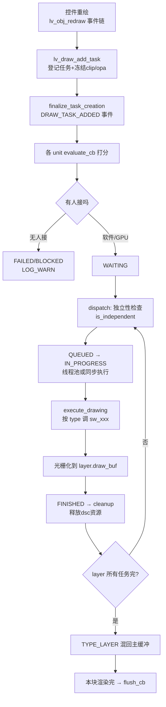
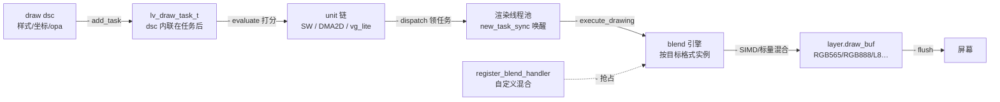

# LVGL 源码详解 03：draw 层精读——绘制任务与软件渲染后端

> 涉及文件：
> - `src/draw/lv_draw.c`（839 行，绘制任务框架 + 调度）
> - `src/draw/lv_draw_private.h`（211 行，task/unit/layer 三大结构）
> - `src/draw/sw/lv_draw_sw.c`（524 行，软件渲染单元）
> - `src/draw/sw/blend/`（各颜色格式的混合实现）
> - `src/draw/sw/lv_draw_sw_mask*.c`（遮罩，`LV_DRAW_SW_COMPLEX=1` 时编译）
> - `src/draw/sw/lv_draw_sw_rect.c`/`fill`/`border`/`box_shadow`/`letter`/`img`…（逐图元实现）

> 配套速查：KB 条目 [lv_draw_sw.md](../../../05-学习笔记与知识库/Knowledge-Base/lvgl/lv_draw_sw.md)

---

## 1. 设计思想：把"画什么"和"怎么画"彻底分离

v8 时代 LVGL 的绘制是"渲染时直接调后端函数"。v9/v10 改成了**任务模型**：

1. 重绘对象树时，控件不再亲手画像素，而是**登记绘制任务**
   （"在 rect A 画一个圆角矩形，样式是 X"）。
2. 每个任务被抛给所有已注册的**绘制单元**（软件单元、GPU 单元）竞标打分。
3. 调度器按分数和依赖关系派发任务，单元各自光栅化。
4. 所有任务完成 → 该块缓冲 flush 上屏。

收益：GPU 单元（DMA2D/PXP/vg_lite）可以只接管自己擅长的任务（比如填充），
其余回落给软件单元；多核可以并行；任务间按区域依赖决定并发安全。

## 2. 三大结构（lv_draw_private.h / lv_draw.c）

| 结构 | 角色 | 关键字段 |
|---|---|---|
| `lv_draw_unit_t` | 渲染器实例 | `dispatch_cb`（领任务）、`evaluate_cb`（竞标打分）、`wait_for_finish_cb`、`delete_cb`、`idx`、`name` |
| `lv_draw_task_t` | 一次绘制请求 | `type`、`area`、`_real_area`、`clip_area`、`opa`、`draw_dsc`（变长描述符）、`state`、`preference_score`、`preferred_draw_unit_id` |
| `lv_layer_t` | 渲染目标 | `draw_buf`、`buf_area`、`_clip_area`、`phy_clip_area`、`opa`、`recolor`、`draw_task_head`（任务链）、`parent`、`color_format` |

任务状态机：`WAITING → QUEUED → IN_PROGRESS → FINISHED`，
旁路 `FAILED`（无人接管）、`BLOCKED`（layer 任务等子任务完成）。

任务类型与描述符大小的映射表（lv_draw.c:733-780 `get_draw_dsc_size`）：

| type | 描述符 | 产生者 |
|---|---|---|
| FILL | `lv_draw_fill_dsc_t` | 矩形背景填充 |
| BORDER | `lv_draw_border_dsc_t` | 边框 |
| BOX_SHADOW | `lv_draw_box_shadow_dsc_t` | 阴影 |
| LETTER / LABEL | `lv_draw_letter/label_dsc_t` | 单字 / 整段文字 |
| IMAGE / LAYER | `lv_draw_image_dsc_t` | 贴图 / 离屏层混回 |
| LINE / ARC / TRIANGLE | 对应 dsc | 线 / 圆弧 / 三角 |
| BLUR / MASK_RECTANGLE / MASK_BITMAP | blur/mask dsc | 模糊 / 矩形遮罩 |
| VECTOR | `lv_draw_vector_dsc_t` | thorvg 矢量（可选） |

## 3. 任务的诞生与竞标

### 3.1 登记：lv_draw_add_task（lv_draw.c:90-127）

```c
    size_t dsc_size = get_draw_dsc_size(type);
    lv_draw_task_t * new_task = lv_malloc_zeroed(LV_ALIGN_UP(sizeof(lv_draw_task_t), 8) + dsc_size);
    ...
    new_task->area = *coords;
    new_task->_real_area = *coords;
    new_task->target_layer = layer;
    new_task->clip_area = layer->_clip_area;      /* :103 冻结当时的裁剪区 */
    new_task->opa = layer->opa;                   /* :107 层透明度一并冻结 */
    new_task->type = type;
    new_task->draw_dsc = (uint8_t *)new_task + LV_ALIGN_UP(sizeof(lv_draw_task_t), 8);  /* :109 描述符紧跟结构体 */
    new_task->state = LV_DRAW_TASK_STATE_WAITING;
```

一次 malloc 装下"任务头 + 描述符"，`draw_dsc` 指向任务体内部的偏移。
`clip_area/opa` 在登记时**快照**——后续绘制单元不再依赖运行中的 layer 状态。

### 3.2 竞标：lv_draw_finalize_task_creation（lv_draw.c:129-198）

```c
    /*Send LV_EVENT_DRAW_TASK_ADDED and dispatch only on the "main" draw_task ...*/
    if(info->task_running == false) {
        if(base_dsc->obj && lv_obj_is_send_draw_task_events(base_dsc->obj)) {
            info->task_running = true;
            lv_obj_send_event(base_dsc->obj, LV_EVENT_DRAW_TASK_ADDED, t);   /* :149 用户可改/拦任务 */
            info->task_running = false;
        }

        /*Let the draw units set their preference score*/
        t->preference_score = 100;
        t->preferred_draw_unit_id = 0;
        lv_draw_unit_t * u = info->unit_head;
        while(u) {
            if(u->evaluate_cb) {
                u->evaluate_cb(u, t);                     /* :161 各单元打分 */
            }
            u = u->next;
        }
        if(t->preferred_draw_unit_id == LV_DRAW_UNIT_NONE) {
            LV_LOG_WARN("Draw task failed (%p, type %d): not taken by any unit");  /* :168 */
            ... 置 FAILED / BLOCKED ...
        }
        lv_draw_dispatch();                               /* :179 顺手派发一轮 */
    }
```

打分约定：分数越低越优先（0 = 该单元独占；100 = 无偏好，谁都能接）。
软件单元的策略（lv_draw_sw.c:229-269）：

```c
    switch(task->type) {
        case LV_DRAW_TASK_TYPE_IMAGE:
        case LV_DRAW_TASK_TYPE_LAYER: {
                lv_draw_image_dsc_t * draw_dsc = task->draw_dsc;
                /* not support skew */
                if(draw_dsc->skew_x != 0 || draw_dsc->skew_y != 0) return 0;      /* :239 错切不给 GPU?不 软件也不接→让GPU */
                bool masked = draw_dsc->bitmap_mask_src != NULL;
                lv_color_format_t cf = draw_dsc->header.cf;
                if(masked && (cf == LV_COLOR_FORMAT_A8 || cf == LV_COLOR_FORMAT_RGB565A8)) return 0;  /* :246 */
                if(cf >= LV_COLOR_FORMAT_PROPRIETARY_START) return 0;             /* :250 厂商私有格式 */
            }
            break;
        ...
    }
    if(task->preference_score >= 100) {
        task->preference_score = 100;
        task->preferred_draw_unit_id = DRAW_UNIT_ID_SW;   /* :265 软件单元兜底 */
    }
```

`DRAW_UNIT_ID_SW = 1`（lv_draw_sw.c:44）。GPU 单元先于软件单元注册
（`lv_draw_create_unit` 头插，lv_draw.c:76-88），GPU 对自己擅长的任务给 0 分
抢先标记；软件单元给所有剩余任务兜底 100 分。都没接 → FAILED 告警。

## 4. 调度：dispatch 的依赖与独立性判定

`lv_draw_dispatch_layer`（lv_draw.c:239-308）每轮做两件事：

1. **回收**：摘掉 FINISHED/FAILED 任务并释放（246-268 行，
   `lv_draw_cleanup_task` 还要释放 line 点数组、layer 资源，782-810 行）。
2. **派发**：对每个 unit 调 `dispatch_cb(u, layer)` 让它自己挑活。

派发安全性靠两条规则：

**规则一：区域独立才可并行**（`is_independent`，lv_draw.c:701-726）：

```c
    lv_draw_task_t * t = layer->draw_task_head;
    /*If t_check is outside of the older tasks then it's independent*/
    while(t && t != t_check) {
        /*It's independent of finished draw tasks, and queued draw tasks of the same draw unit, ...*/
        if(t->state == LV_DRAW_TASK_STATE_FINISHED ||
           (t->state == LV_DRAW_TASK_STATE_QUEUED && t->preferred_draw_unit_id == draw_unit_id)) {
            t = t->next;
            continue;
        }
        lv_area_t a;
        if(lv_area_intersect(&a, &t->_real_area, &t_check->_real_area)) {
            return false;                     /* :717 与更早的未完成任务重叠 → 不能并行 */
        }
        t = t->next;
    }
```

绘制是"后画的盖先画的"，两个任务区域重叠时**顺序**即结果——多线程并行会
产生竞态脏像素。只有当候选任务与所有更早的未完成任务都不相交时才可并发。

**规则二：单单元时线性消费**（`get_first_available_task`，lv_draw.c:812-839）：
只有一个绘制单元时任务按登记顺序直接消费，不再做独立判定——
但遇到 `TYPE_LAYER`（整层混合）任务时必须停下，先把该层的子任务画完
（状态 WAITING→可执行），否则 layer 混合时子内容还没画好。

`lv_draw_get_next_available_task`（350-382 行）按
"WAITING + 单元匹配（或无偏好）+ is_independent" 过滤，返回下一个可执行任务。

## 5. 软件单元：lv_draw_sw.c 全流程

### 5.1 初始化（lv_draw_sw_init，80-134 行）

```c
    lv_draw_sw_unit_t * draw_sw_unit = lv_draw_create_unit(sizeof(lv_draw_sw_unit_t));
    draw_sw_unit->base_unit.dispatch_cb = dispatch;
    draw_sw_unit->base_unit.evaluate_cb  = evaluate;
#if LV_USE_OS != LV_OS_NONE
    draw_sw_unit->base_unit.wait_for_finish_cb = wait_for_finish;
#endif
    ...
#if LV_USE_OS
    uint32_t i;
    for(i = 0; i < LV_DRAW_SW_DRAW_UNIT_CNT; i++) {
        lv_draw_sw_thread_dsc_t * thread_dsc = &draw_sw_unit->thread_dscs[i];
        thread_dsc->idx = i;
        ...
        lv_thread_init(&thread_dsc->thread, "swdraw", LV_DRAW_THREAD_PRIO, render_thread_cb,
                       LV_DRAW_THREAD_STACK_SIZE, thread_dsc);      /* :119 渲染线程 */
    }
#endif
```

- `LV_DRAW_SW_DRAW_UNIT_CNT`（lv_conf_template.h:271，默认 1）是渲染线程数。
- 线程优先级/栈：`LV_DRAW_THREAD_PRIO`（默认 3，lv_conf_template.h:203）、
  `LV_DRAW_THREAD_STACK_SIZE`（8192 B，lv_conf_template.h:190）。
- **开多线程必须先有 OS**：lv_draw_sw.c:37-39 编译期断言
  `LV_DRAW_SW_DRAW_UNIT_CNT > 1 && LV_USE_OS == LV_OS_NONE` 直接报错。

### 5.2 无 OS 单线程执行（dispatch 的 #else 分支，333-366 行）

```c
    /*Return immediately if it's busy with draw task*/
    if(draw_sw_unit->task_act) return 0;

    lv_draw_task_t * t = lv_draw_get_available_task(layer, NULL, DRAW_UNIT_ID_SW);
    if(t == NULL) return LV_DRAW_UNIT_IDLE;

    void * buf = lv_draw_layer_alloc_buf(layer);
    if(buf == NULL) {
        t->state = LV_DRAW_TASK_STATE_FAILED;
        return LV_DRAW_UNIT_IDLE;
    }

    t->state = LV_DRAW_TASK_STATE_IN_PROGRESS;
    draw_sw_unit->task_act = t;

    execute_drawing(t);                                  /* :357 同步执行 */
    draw_sw_unit->task_act->state = LV_DRAW_TASK_STATE_FINISHED;
    draw_sw_unit->task_act = NULL;

    /*The draw unit is free now. Request a new dispatching as it can get a new task*/
    lv_draw_dispatch_request();                          /* :362 唤醒调度循环 */
```

裸机（`LV_USE_OS_NONE`）下整个渲染在 `lv_timer_handler` 调用线程内同步完成，
`lv_draw_dispatch_wait_for_request` 退化成对标志位自旋（lv_draw.c:316-318）。

### 5.3 有 OS 线程池执行（dispatch 271-331 行 + render_thread_cb 371-402 行）

主线程 dispatch 只做"领任务 + 信号量唤醒"：

```c
        t = lv_draw_get_next_available_task(layer, t, DRAW_UNIT_ID_SW);
        ...
        t->state = LV_DRAW_TASK_STATE_IN_PROGRESS;
        thread_dsc->task_act = t;
        lv_thread_sync_signal(&thread_dsc->new_task_sync);   /* :326 通知渲染线程 */
```

渲染线程死循环等活干活：

```c
    while(1) {
        while(thread_dsc->task_act == NULL) {
            if(thread_dsc->exit_status) break;
            lv_thread_sync_wait(&thread_dsc->new_task_sync);   /* :380 休眠等任务 */
        }
        ...
        execute_drawing((lv_draw_task_t *)thread_dsc->task_act); /* :388 */
        thread_dsc->task_act->state = LV_DRAW_TASK_STATE_FINISHED;
        thread_dsc->task_act = NULL;
        lv_thread_sync_signal(&thread_dsc->task_done_sync);
        lv_draw_dispatch_request();                            /* :397 让调度器继续派活 */
    }
```

### 5.4 执行分派：execute_drawing（417-469 行）

```c
    switch(t->type) {
        case LV_DRAW_TASK_TYPE_FILL:        lv_draw_sw_fill(t, t->draw_dsc, &t->area);        break;
        case LV_DRAW_TASK_TYPE_BORDER:      lv_draw_sw_border(t, t->draw_dsc, &t->area);      break;
        case LV_DRAW_TASK_TYPE_BOX_SHADOW:  lv_draw_sw_box_shadow(t, t->draw_dsc, &t->area);  break;
        case LV_DRAW_TASK_TYPE_LETTER:      lv_draw_sw_letter(t, t->draw_dsc, &t->area);      break;
        case LV_DRAW_TASK_TYPE_LABEL:       lv_draw_sw_label(t, t->draw_dsc, &t->area);       break;
        case LV_DRAW_TASK_TYPE_IMAGE:       lv_draw_sw_image(t, t->draw_dsc, &t->area);       break;
        case LV_DRAW_TASK_TYPE_ARC:         lv_draw_sw_arc(t, t->draw_dsc, &t->area);         break;
        case LV_DRAW_TASK_TYPE_LINE:        lv_draw_line_iterate(t, t->draw_dsc, lv_draw_sw_line); break;
        case LV_DRAW_TASK_TYPE_BLUR:        lv_draw_sw_blur(t, t->draw_dsc, &t->area);        break;
        case LV_DRAW_TASK_TYPE_TRIANGLE:    lv_draw_sw_triangle(t, t->draw_dsc);              break;
        case LV_DRAW_TASK_TYPE_LAYER:       lv_draw_sw_layer(t, t->draw_dsc, &t->area);       break;
        case LV_DRAW_TASK_TYPE_MASK_RECTANGLE: lv_draw_sw_mask_rect(t, t->draw_dsc);          break;
        ...
    }
```

每个 `lv_draw_sw_xxx` 内部把"画什么"翻译成对 `blend` 引擎的一次或多次调用。

## 6. 混合引擎与颜色格式

`src/draw/sw/blend/` 按**目标缓冲格式**分文件：

| 文件 | 目标格式 |
|---|---|
| `lv_draw_sw_blend_to_rgb565.c` | RGB565 |
| `lv_draw_sw_blend_to_rgb888.c` / argb8888（含 premultiplied） | 24/32 位 |
| `lv_draw_sw_blend_to_l8.c` / al88 / a8 | L8 灰度 / AL88 / A8 纯 alpha |
| `lv_draw_sw_blend_to_rgb565_swapped.c` | 字节序翻转屏 |

混合统一走"目标像素 × (1-opa) + 源像素 × opa"，填充/贴图/文字共用这一层，
由 `lv_draw_sw_blend`（带 `lv_draw_sw_blend_fill_dsc_t/blend_dsc_t`）分发。
自定义加速点：`lv_draw_sw_register_blend_handler`（lv_draw_sw.c:172-195）
允许用户按目标格式注册自己的混合实现（比如用 DSP/自定义 SIMD 接管 RGB565 混合）。

**SIMD 路径**：`LV_USE_DRAW_SW_ASM`（lv_conf_template.h:314）可选
NEON / Helium / RISCV_V / SVE2 / CUSTOM，单元名也随之后缀化
（lv_draw_sw.c:95-109，如 "SW_NEON"）。

## 7. mask 机制（LV_DRAW_SW_COMPLEX）

`src/draw/sw/lv_draw_sw_mask.c` + `lv_draw_sw_mask_private.h` 提供 8 位
alpha 遮罩的运行时生成：

| 遮罩类型 | 用途 |
|---|---|
| RADIUS | 圆角矩形裁剪（clip_corner 效果，见 lv_refr.c:188-241 的 `lv_draw_mask_rect`） |
| LINE | 斜线/多边形边缘 |
| ANGLE | 圆弧端点 |
| FADE | 渐隐（roller 边缘） |
| MAP | 位图 alpha 表（bitmap_mask_src 样式） |

实现是"逐行生成 alpha 条 + 与源混合"，带行缓存
（`LV_DRAW_SW_SHADOW_CACHE_SIZE`/circle cache，lv_conf_template.h:296-301，
阴影缓存默认关、圆形缓存 4 项）。每帧结束后
`lv_draw_sw_mask_cleanup()`（lv_refr.c:450-452）统一释放缓存条目。

## 8. 任务生命周期图



## 9. 像素流水线（数据流）



## 10. 陷阱与实测建议

1. **多单元 + 裸机编不过**：`LV_DRAW_SW_DRAW_UNIT_CNT>1` 强制要求 OS
   （lv_draw_sw.c:37-39）。单核 RTOS 想多开线程没有意义——线程数 <= 核数。
2. **`LV_DRAW_TASK_ADDED` 事件里别递归添加任务**：框架用 `task_running`
   标志只对"主任务"发事件（lv_draw.c:146-151），事件回调里 add_task 不会
   再触发嵌套事件——但会参与 dispatch。
3. **FAILED 任务的常见原因**：GPU 单元声明了偏好但初始化失败、
   私有颜色格式无人接管。日志 "Draw task failed (…): not taken by any unit"
   （lv_draw.c:168）出现时先查 GPU init 返回值。
4. **阴影/圆角最耗 CPU**：`LV_DRAW_SW_COMPLEX=1` 是它们的前提；
   阴影缓存 `LV_DRAW_SW_SHADOW_CACHE_SIZE` 设为 0（默认）在阴影频繁重画时
   打开可显著降载，代价是额外 RAM。
5. **双缓冲 DIRECT 模式下任务并行度最高**：整屏缓冲 + tile 切片 +
   独立性判定，多核可吃满；PARTIAL 模式每条很小，并行收益有限。
6. **调 GPU 接管率**：开 `LV_USE_PARALLEL_DRAW_DEBUG`（lv_draw_sw.c:63-65、
   471-521 行）能给每个任务盖上"哪个线程画的"染色标签，直观验证并行与竞标。
