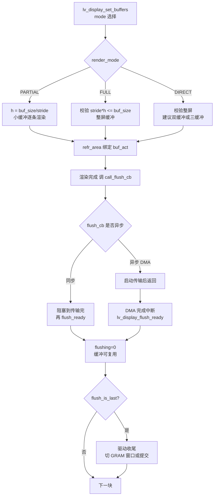
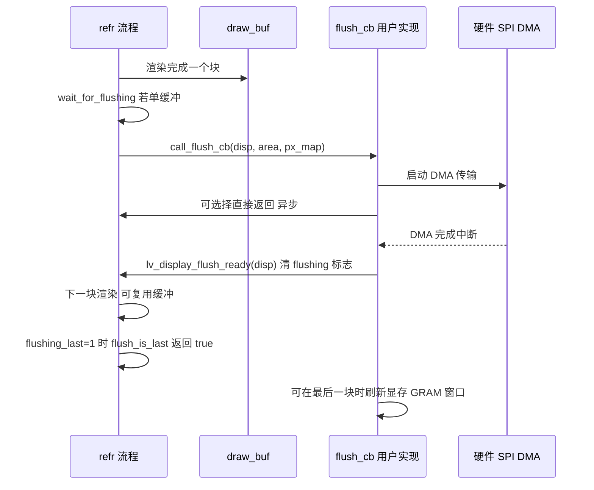
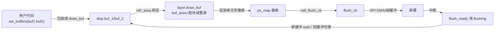

# LVGL 源码详解 04：显示驱动接口——display 抽象与 flush 契约

> 涉及文件：
> - `src/display/lv_display.c`（1742 行，显示器抽象全实现）
> - `src/display/lv_display_private.h`（216 行，`lv_display_t` 结构与脏区字段）
> - `README.md:203-271`（官方最小移植示例）

> 配套速查：KB 条目 [lv_display.md](../../../05-学习笔记与知识库/Knowledge-Base/lvgl/lv_display.md)

---

## 1. display 是什么：驱动的"接口插座"

LVGL 不含任何具体屏驱动。`lv_display_t` 是一个**插座**：移植者把分辨率、
缓冲、两个回调插上，库就认为"这块屏存在了"：

| 插槽 | 类型 | 必须 | 作用 |
|---|---|---|---|
| `hor_res/ver_res` | int32 | 是 | 逻辑分辨率 |
| `flush_cb` | 回调 | 是 | 把渲染好的像素块送到屏/帧缓冲 |
| `buf_1`（可选 buf_2/buf_3） | draw_buf | 是 | 渲染缓冲 |
| `render_mode` | 枚举 | 是 | PARTIAL / FULL / DIRECT |
| `color_format` | 枚举 | 否（默认 RGB565 等） | 与缓冲格式一致 |
| `flush_wait_cb` | 回调 | 否 | 自定义"等 flush 完成"实现 |
| `sync_cb/sync_wait_cb` | 回调 | 否 | 双 DIRECT 缓冲区域同步 |
| `theme` | lv_theme_t | 否 | 该屏的主题 |
| `driver_data/user_data` | void* | 否 | 驱动私有数据挂载点 |

`flush_cb` 函数签名（lv_display_private.h:76-78 注释原文）：

```c
    /** MANDATORY: Write the internal buffer (draw_buf) to the display. 'lv_display_flush_ready()' has to be
     * called when finished*/
    lv_display_flush_cb_t flush_cb;
```

## 2. lv_display_t 字段地图（lv_display_private.h:37-194）

| 分组 | 字段 | 行号 | 说明 |
|---|---|---|---|
| 分辨率 | hor_res / ver_res | 46-49 | 逻辑分辨率 |
| | physical_hor/ver_res, offset_x/y | 51-61 | 物理屏裁剪/偏移（多屏拼接） |
| | dpi | 64 | 默认 `LV_DPI_DEF` |
| 缓冲 | buf_1 / buf_2 / buf_3 | 69-71 | 1~3 块缓冲 |
| | buf_act | 74 | 当前渲染用哪块 |
| | flush_cb | 78 | 上屏回调（必须） |
| | flush_wait_cb | 84 | 自定义等待；未设则轮询 flushing 标志 |
| | flushing / flushing_last | 88-92 | 握手标志（volatile，中断可写） |
| | last_area / last_part | 93-94 | 本块是最后一块/当前区最后一条 |
| 同步 | sync_cb / sync_wait_cb / syncing | 99-113 | 双 DIRECT 缓冲同步 |
| | sync_areas | 116 | 待同步区域链表 |
| 模式 | render_mode | 118 | 三种渲染模式 |
| | antialiasing / tile_cnt / stride_is_auto | 119-121 | 抗锯齿/切片数/自动步长 |
| | rendering_in_progress | 125 | 渲染中标志（失效断言用） |
| 脏区 | color_format | 127 | |
| | inv_areas[32] / inv_area_joined / inv_p | 130-132 | 脏区数组（02 篇详解） |
| | inv_en_cnt | 133 | 失效使能计数 |
| | _static_buf1/_static_buf2 | 135-136 | 用户裸缓冲的包装 |
| 屏树 | layer_head | 140 | 根 layer |
| | screens[] / screen_cnt | 147-154 | 所有 screen |
| | sys_layer / top_layer / act_scr / bottom_layer / prev_scr / scr_to_load | 148-153 | 层级与切屏 |
| 其他 | rotation / matrix_rotation | 168-170 | 旋转 |
| | theme | 172 | |
| | refr_timer | 175 | 刷新定时器（02 篇主角） |
| | last_activity_time | 178 | 输入不活跃计时 |

## 3. 创建流程：lv_display_create（lv_display.c:81-201）

```c
lv_display_t * lv_display_create(int32_t hor_res, int32_t ver_res)
{
    lv_display_t * disp = lv_ll_ins_head(disp_ll_p);        /* :85 头插进全局显示器链表 */
    lv_memzero(disp, sizeof(lv_display_t));

    disp->hor_res          = hor_res;
    disp->ver_res          = ver_res;
    disp->physical_hor_res = -1;                            /* :93 -1 = 未裁剪 */
    disp->antialiasing     = LV_COLOR_DEPTH > 8 ? 1 : 0;    /* :97 */
    disp->dpi              = LV_DPI_DEF;
    disp->color_format = LV_COLOR_FORMAT_DEFAULT;           /* :99 */
    disp->tile_cnt = DEFAULT_TILE_CNT;                      /* :105 = 绘制单元数 */
    ...
    disp->layer_head = lv_draw_layer_create(NULL, disp->color_format, &disp_area);  /* :115 根层 */
    disp->inv_en_cnt = 1;
    disp->last_activity_time = lv_tick_get();
    lv_ll_init(&disp->sync_areas, sizeof(lv_area_t));

    disp->refr_timer = lv_timer_create(lv_display_refr_timer, LV_DEF_REFR_PERIOD, disp);  /* :131 */
    ...
#if LV_USE_THEME_DEFAULT
    disp->theme = lv_theme_default_init(disp, ...);         /* :140 默认主题自动挂 */
#endif
    disp->bottom_layer = lv_obj_create(NULL);               /* :162 */
    disp->act_scr   = lv_obj_create(NULL);                  /* :163 默认屏 */
    disp->top_layer = lv_obj_create(NULL);                  /* :164 */
    disp->sys_layer = lv_obj_create(NULL);                  /* :165 */
    lv_obj_remove_style_all(disp->bottom_layer);
    lv_obj_remove_style_all(disp->top_layer);
    lv_obj_remove_style_all(disp->sys_layer);
    lv_obj_set_clickable(disp->top_layer, false);
    lv_obj_set_clickable(disp->sys_layer, false);
    ...
    lv_obj_invalidate(disp->act_scr);                       /* :183 首屏全屏脏区 */
    disp_def = disp_def_tmp;
    if(disp_def == NULL) disp_def = disp;                   /* :186 第一个 display 即默认 */
    lv_timer_ready(disp->refr_timer);                       /* :190 开机立刻刷一次 */
    ...
}
```

四个"屏级"对象的层级关系（绘制顺序从下到上）：

| 对象 | Z 序 | 用途 |
|---|---|---|
| bottom_layer | 最底 | 屏幕背景色（lv_display.c:176 默认不透明） |
| act_scr / 其他 screen | 中 | 应用页面 |
| top_layer | 高 | 覆盖层（弹窗遮罩类） |
| sys_layer | 最高 | 系统层（鼠标光标、拖拽预览） |

top/sys 层不可点击（169-170 行）；这三个层的滚动条被关闭（179-181 行）。
创建期间临时把 `disp_def` 指向新屏（127-128 行），保证四个屏对象建在正确的
display 上，随后恢复。

## 4. 缓冲三模式：set_buffers 的校验与含义（lv_display.c:538-586）

```c
void lv_display_set_buffers_with_stride(lv_display_t * disp, void * buf1, void * buf2, uint32_t buf_size,
                                        uint32_t stride, lv_display_render_mode_t render_mode)
{
    lv_color_format_t cf = lv_display_get_color_format(disp);
    uint32_t w = lv_display_get_original_horizontal_resolution(disp);
    uint32_t h = lv_display_get_original_vertical_resolution(disp);
    ...
    /* buf1 or buf2 is not aligned according to LV_DRAW_BUF_ALIGN */
    LV_CHECK_ARG_FORMAT_MSG(buf1 == lv_draw_buf_align(buf1, cf), return, "buf1 is not properly aligned: %p", buf1);
    ...
    bool is_auto_stride = stride == LV_STRIDE_AUTO;
    if(is_auto_stride) {
        stride = lv_draw_buf_width_to_stride(w, cf);       /* :565 自动步长 */
    }

    if(render_mode == LV_DISPLAY_RENDER_MODE_PARTIAL) {
        /* for partial mode, we calculate the height based on the buf_size and stride */
        h = buf_size / stride;                             /* :571 PARTIAL 由字节量反推行数 */
        LV_CHECK_ARG_MSG(h, return, "the buffer is too small");
    }
    else {
        LV_CHECK_ARG_FORMAT_MSG(stride * h <= buf_size, return, "%s mode requires screen sized buffer(s)",
                                render_mode == LV_DISPLAY_RENDER_MODE_FULL ? "FULL" : "DIRECT");  /* :575 */
    }

    lv_draw_buf_init(&disp->_static_buf1, w, h, cf, stride, buf1, buf_size);
    if(buf2) lv_draw_buf_init(&disp->_static_buf2, ...);
    lv_display_set_draw_buffers(disp, &disp->_static_buf1, buf2 ? &disp->_static_buf2 : NULL);
    lv_display_set_render_mode(disp, render_mode);
}
```

三种模式的本质（对照 02 篇 refr_invalid_areas 的分块逻辑）：

| 模式 | 缓冲大小 | 渲染位置 | 优缺点 |
|---|---|---|---|
| PARTIAL | 任意（推荐 1/10 屏） | 缓冲坐标 = 屏幕局部坐标，逐条渲染即 flush | RAM 最省；flush 次数多；缓冲击中率决定效率 |
| FULL | 整屏 | 整屏缓冲，只刷脏区，整屏 flush | 实现最简单的驱动（一次性整屏写） |
| DIRECT | 整屏（建议 ×2 或 ×3） | 直接在帧缓冲上画脏区，硬件自动显示 | 无需拷贝/传输；渲染区域外旧画面保留；双缓冲需 sync |

PARTIAL 下的往返次数估算：脏区 H 行、缓冲可容纳 R 行 → `ceil(H/R)` 次
flush（lv_refr.c:835-856 的 for + 补尾部循环）。

## 5. flush 握手协议

### 5.1 上屏执行流



### 5.2 握手时序



协议要点：

1. **必须调用 `lv_display_flush_ready(disp)`**（lv_display.c:756-760，
   `disp->flushing = 0`）。库靠这个标志等待缓冲可用（`wait_for_flushing`）。
   它可在中断/线程中调用（`LV_ATTRIBUTE_FLUSH_READY` 修饰）。
2. **`flushing`/`flushing_last` 故意不用位域**：private.h:86-92 注释写明
   "It can't be a bit field because when it's cleared from IRQ Read-Modify-Write
   issue might occur"——中断清标志与主线程读改写会竞争。
3. **`lv_display_flush_is_last`**（762-766 行）告诉 flush_cb 当前是否最后一块：
   有的驱动（如 ILI9341 类 GRAM 屏）需要最后一块后才能切窗口/刷显存。
4. **等完再渲染**：单缓冲时 `refr_configured_layer` 显式
   `wait_for_flushing`（lv_refr.c:1058-1060）；双缓冲则上一块还在 DMA 时
   就可以用另一块继续渲染——这是双缓冲的性能来源。
5. **异步最优**：flush_cb 启动 DMA 后立即返回，`flush_ready` 由 DMA 完成中断调；
   如果没有中断条件，可以在 flush_cb 里阻塞到传完再返回（简单但慢）。

### sync_cb：双 DIRECT 缓冲的画面同步

DIRECT + 双缓冲时，两块缓冲各自持有"部分更新"的画面。下一次渲染前，
必须把本轮画过的区域从"屏幕上显示的缓冲"拷到"将要渲染的缓冲"，
保持两者一致。框架自动记录 sync_areas（lv_refr.c:432-442），并支持两条路径：

- 用户驱动自己拷（设 `sync_cb`，lv_display.c:631-640）；
- 库内部 `lv_draw_buf_copy` 兜底（lv_refr.c:776-781），三缓冲时对第三块也同步。

## 6. 双屏与默认屏

```c
    lv_display_t * disp_a = lv_display_create(320, 240);
    lv_display_set_buffers(disp_a, buf_a, NULL, sizeof(buf_a), LV_DISPLAY_RENDER_MODE_PARTIAL);
    lv_display_set_flush_cb(disp_a, flush_a);

    lv_display_t * disp_b = lv_display_create(128, 64);
    ...
```

- 每个 display 独立的屏树/脏区/refr_timer/主题，互不干扰。
- `lv_display_set_default`（267-270 行）只改一个指针 `disp_def`；
  `lv_obj_create(NULL)` 等 NULL 父级的调用在默认 display 上建屏。
- 指定屏幕创建对象：`lv_obj_create(NULL)` 后 `lv_display_set_screen_active`，
  或控件 API 的 `lv_<widget>_create(screen)` 直接传目标屏。
- 输入设备也要绑定屏：`lv_indev_set_display(indev, disp_a)`。

物理屏裁剪/偏移（`set_physical_resolution`/`set_offset`，307-330 行）服务
"一块大物理屏划出两个逻辑屏"的拼接场景；旋转用 `set_rotation`。

## 7. 缓冲尺寸与内存账

RGB565（2 B/px）常用配置速算：

| 屏 | 模式 | 缓冲 | 字节数 |
|---|---|---|---|
| 240×240 小圆屏 | PARTIAL 1/4 | 240×60×2 | 28.8 KB |
| 320×240 | PARTIAL 1/10 | 320×24×2 | 15.4 KB |
| 320×240 | FULL/DIRECT | 320×240×2 | 150 KB |
| 800×480 | DIRECT 双缓冲 | 800×480×2×2 | 1.5 MB |

stride（行字节数）：`LV_DRAW_BUF_STRIDE_ALIGN`（lv_conf_template.h:159 默认 1）
与格式共同决定；给 GPU/特定 LCD 用时可用 `lv_display_set_buffers_with_stride`
显式指定对齐步长（lv_display.c:546）。

## 8. 数据流：一块缓冲的一生



## 9. 陷阱与实测建议

1. **缓冲未对齐直接拒绝**：lv_display.c:559-561 校验
   `buf1 == lv_draw_buf_align(buf1, cf)`；DMA 硬件要求对齐时（如 4 字节），
   在 lv_conf.h 调 `LV_DRAW_BUF_ALIGN`，或手动对齐传入指针。
2. **`lv_display_delete` 后 refr_timer 一并删除**（249 行），但用户侧保存的
   disp 指针变悬空；默认 display 会自动顺延到链表头部（262 行）。
3. **flush_cb 里禁止调 LVGL API 改 UI**：此时 `rendering_in_progress=1`，
   任何 invalidate 都会触发断言（lv_refr.c:289）。要通知应用层用
   `LV_EVENT_FLUSH_START/FINISH` 事件。
4. **PARTIAL 模式的 `area` 是屏幕绝对坐标**，而 `px_map` 从 0 开始——
   驱动设置窗口时用 `area->x1/x2/y1/y2`，写数据用 px_map 全量。
5. **三缓冲（buf_3）**：`lv_display_set_buffers` 只支持 buf1/buf2，
   第三块用 `lv_display_set_3rd_draw_buffer`（lv_display.c:523-536），
   服务"双 DIRECT + 传输中再持一块"的低延迟场景。
6. **`lv_display_set_antialiasing` 已废弃**：lv_display.c:723 直接打日志
   "Disabling anti-aliasing is not supported since v9"——抗锯齿由渲染器保证，
   别再指望这个开关省性能。
7. **分辨率变更**用 `lv_display_set_resolution`（289-305 行），
   它会触发 `update_resolution`（1530 行起）同步屏幕对象坐标与脏区；
   窗口拖拽类的 PC 驱动就在这条路径上。
