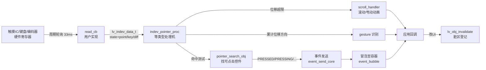
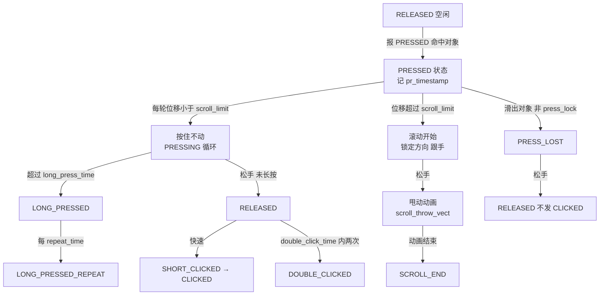

# LVGL 源码详解 05：输入设备与触控

> 涉及文件：
> - `src/indev/lv_indev.c`（2053 行，输入抽象 + 指针/按键状态机）
> - `src/indev/lv_indev_scroll.c`（774 行，滚动逻辑与手感）
> - `src/indev/lv_indev_gesture.c`（1016 行，手势识别）
> - `src/indev/lv_gridnav.c`（网格导航）
> - `src/core/lv_group.c`（577 行，编码器/键盘的焦点组）

> 配套速查：KB 条目 [lv_event.md](../../../05-学习笔记与知识库/Knowledge-Base/lvgl/lv_event.md)
> （事件如何从 indev 到控件）

---

## 1. 输入抽象：read_cb 契约

LVGL 不含触摸驱动。移植者提供**轮询式回调**：

```c
static void my_touch_read_cb(lv_indev_t * indev, lv_indev_data_t * data)
{
   if(my_touch_is_pressed()) {
       data->point.x = touchpad_x;
       data->point.y = touchpad_y;
       data->state = LV_INDEV_STATE_PRESSED;
   } else {
       data->state = LV_INDEV_STATE_RELEASED;
   }
}
```

（README.md:223-232 官方示例。）契约要素：

| 要素 | 说明 |
|---|---|
| 类型 | `lv_indev_type_t`：POINTER / KEYPAD / ENCODER / BUTTON / ROTARY / NONE |
| 状态 | `LV_INDEV_STATE_PRESSED` / `RELEASED`（每轮都报，不只报变化） |
| 轮询周期 | read_timer 默认 `LV_DEF_REFR_PERIOD`（33 ms），lv_indev.c:111 |
| 补充报点 | `data->continue_reading = true` 让本轮立刻再读一次 |
| 时间戳 | 不填则框架补 `lv_tick_get()`（lv_indev.c:193） |

框架侧的读取核心 `indev_read_core`（lv_indev.c:170-200）：

```c
static void indev_read_core(lv_indev_t * indev, lv_indev_data_t * data)
{
    lv_memzero(data, sizeof(lv_indev_data_t));

    /* For touchpad sometimes users don't set the last pressed coordinate on release.
     * So be sure a coordinates are initialized to the last point */
    if(indev->type == LV_INDEV_TYPE_POINTER) {
        data->point.x = indev->pointer.last_raw_point.x;    /* :180 释放时漏填坐标也能用 */
        data->point.y = indev->pointer.last_raw_point.y;
    }
    /*Similarly set at least the last key in case of the user doesn't set it on release*/
    else if(indev->type == LV_INDEV_TYPE_KEYPAD || indev->type == LV_INDEV_TYPE_ENCODER) {
        data->key = indev->keypad.last_key;
    }

    if(indev->read_cb) {
        indev->read_cb(indev, data);                        /* :190 调用户回调 */
        /*Set the time stamp to the current time is it was not set in the read_cb*/
        if(data->timestamp == 0) data->timestamp = lv_tick_get();
    }
}
```

轮询主循环 `lv_indev_read`（208-275 行）的关键分支：

```c
    /*Handle reset query before processing the point*/
    indev_proc_reset_query_handler(indev);              /* :220 先处理"对象被删"复位请求 */

    if(indev->enabled == 0) return;
    if(indev->disp->prev_scr != NULL) {
        LV_TRACE_INDEV("input blocked while screen animation active");   /* :223-226 切屏动画期间封锁 */
        return;
    }

    bool continue_reading;
    lv_indev_data_t data;
    do {
        indev_read_core(indev, &data);
        continue_reading = indev->mode != LV_INDEV_MODE_EVENT && data.continue_reading;  /* :236 */
        indev->state = data.state;
        /*Save the last activity time*/
        if(indev->state == LV_INDEV_STATE_PRESSED) {
            indev->disp->last_activity_time = data.timestamp;      /* :246-248 活跃计时 */
        }
        ...
        if(indev->type == LV_INDEV_TYPE_POINTER)       indev_pointer_proc(indev, &data);
        else if(indev->type == LV_INDEV_TYPE_KEYPAD)   indev_keypad_proc(indev, &data);
        else if(indev->type == LV_INDEV_TYPE_ENCODER)  indev_encoder_proc(indev, &data);
        else if(indev->type == LV_INDEV_TYPE_BUTTON)   indev_button_proc(indev, &data);
        indev_proc_reset_query_handler(indev);          /* :266 处理过程中对象被删的复位 */
    } while(continue_reading);
```

`last_activity_time` 是 `lv_display_get_inactive_time()` 的数据源，
"15 s 无操作自动熄屏"类功能直接查它，不需要应用自己计时。

## 2. 创建与手感参数（lv_indev_create，94-135 行）

```c
    indev->read_timer = lv_timer_create(lv_indev_read_timer_cb, LV_DEF_REFR_PERIOD, indev);  /* :111 */
    ...
    indev->scroll_limit           = LV_INDEV_DEF_SCROLL_LIMIT;      /* 10 px */
    indev->scroll_throw           = LV_INDEV_DEF_SCROLL_THROW;      /* 10 */
    indev->long_press_time        = LV_INDEV_DEF_LONG_PRESS_TIME;   /* 400 ms */
    indev->long_press_repeat_time = LV_INDEV_DEF_LONG_PRESS_REP_TIME;
    indev->double_click_time      = LV_INDEV_DEF_DOUBLE_CLICK_TIME;
    indev->gesture_min_distance   = LV_INDEV_DEF_GESTURE_LIMIT;     /* 50 px */
    indev->gesture_min_velocity   = LV_INDEV_DEF_GESTURE_MIN_VELOCITY;
    indev->rotary_sensitivity     = LV_INDEV_DEF_ROTARY_SENSITIVITY;
```

手感参数表（lv_conf_template.h 默认值）：

| 参数 | 默认 | 含义 | 调参效果 |
|---|---|---|---|
| scroll_limit | 10 px（:676） | 位移超过它才算"滚动"而非点击 | 调小灵敏但误滚多 |
| scroll_throw | 10（:679） | 甩动衰减系数（惯性步进） | 大=甩得更远 |
| long_press_time | 400 ms（:685） | 长按判定 | |
| long_press_repeat_time | 300 ms | 长按后连发间隔 | |
| double_click_time | 300 ms | 双击窗口 | |
| gesture_limit | 50 px（:694） | 手势最小位移 | |
| gesture_min_velocity | 3 px/frame | 手势最小速度 | |

这些都可用 `lv_indev_set_scroll_limit()` 等运行时覆盖单个设备。

## 3. 指针状态机：从触摸到 CLICKED

`indev_pointer_proc`（752 行）每轮调用，根据 data.state 走 press 或 release。
按下侧 `indev_proc_press`（1288-1487 行）的完整决策：

```c
static void indev_proc_press(lv_indev_t * indev)
{
    indev_obj_act = indev->pointer.act_obj;
    if(indev->wait_until_release != 0) return;          /* :1295 等待强制释放 */

    /*If there is no last object then search*/
    if(indev_obj_act == NULL) {
        indev_obj_act = pointer_search_obj(disp, &indev->pointer.act_point);  /* :1302 命中测试 */
        new_obj_searched = true;
    }
    ...
    /*If a new object was found reset some variables and send a pressed event handler*/
    if(indev_obj_act != indev->pointer.act_obj) {
        ...
        /*If a new object found the previous was lost, so send a PRESS_LOST event*/
        if(indev->pointer.act_obj != NULL) {
            lv_obj_t * prev_act_obj = indev->pointer.act_obj;
            lv_obj_send_event(prev_act_obj, LV_EVENT_PRESS_LOST, indev_act);  /* :1348 */
            ...
        }
        indev->pointer.act_obj  = indev_obj_act;
        if(indev_obj_act != NULL) {
            /*Save the time when the obj pressed to count long press time.*/
            indev->pr_timestamp                 = indev->timestamp;      /* :1357 */
            indev->long_pr_sent                 = 0;
            indev->pointer.scroll_sum.x     = 0;                         /* :1359 清零滚动累计 */
            ...
            if(indev->prev_state != LV_INDEV_STATE_PRESSED) {
                const bool is_enabled = !lv_obj_has_state(indev_obj_act, LV_STATE_DISABLED);
                if(is_enabled) {
                    ...
                    if(send_event(LV_EVENT_PRESSED, indev_act) == LV_RESULT_INVALID) return;  /* :1382 */
                }
            }
            /*Handle focus*/
            indev_click_focus(indev_act);                                /* :1389 */
        }
    }

    /*Update vector and scroll throw vector*/
    indev->pointer.vect.x = indev->pointer.act_point.x - indev->pointer.last_point.x;  /* :1396 */
    indev->pointer.vect.y = indev->pointer.act_point.y - indev->pointer.last_point.y;

    indev->pointer.vect_hist[indev->pointer.vect_hist_index] = indev->pointer.vect;    /* :1399 历史环形数组 */
    indev->pointer.vect_hist_timestamp[indev->pointer.vect_hist_index] = indev->timestamp;
    indev->pointer.vect_hist_index = (indev->pointer.vect_hist_index + 1) % LV_INDEV_VECT_HIST_SIZE;
    ...
    for(int i = 0; i < LV_INDEV_VECT_HIST_SIZE; i++) {   /* :1405 按时间加权合成甩动向量 */
        int32_t t = lv_tick_diff(indev->timestamp, indev->pointer.vect_hist_timestamp[i]);
        indev->pointer.scroll_throw_vect.x += indev_scroll_throw_decay(indev->pointer.vect_hist[i].x, t);
        indev->pointer.scroll_throw_vect.y += indev_scroll_throw_decay(indev->pointer.vect_hist[i].y, t);
    }
    ...
    if(LV_ABS(indev->pointer.vect.x) > indev->scroll_limit || LV_ABS(indev->pointer.vect.y) > indev->scroll_limit) {
        indev->pointer.press_moved = 1;                  /* :1413 超过滚动阈值：不再是点击 */
    }
    ...
    if(indev_obj_act) {
        const bool is_enabled = !lv_obj_has_state(indev_obj_act, LV_STATE_DISABLED);
        if(is_enabled) {
            if(send_event(LV_EVENT_PRESSING, indev_act) == LV_RESULT_INVALID) return;  /* :1442 每轮 PRESSING */
        }
        ...
        lv_indev_scroll_handler(indev);                  /* :1452 滚动处理 */
        ...
        /*If there is no scrolling then check for long press time*/
        if(indev->pointer.scroll_obj == NULL && indev->long_pr_sent == 0) {
            /*Send a long press event if enough time elapsed*/
            if(lv_tick_diff(indev->timestamp, indev->pr_timestamp) >= indev_act->long_press_time) {
                if(is_enabled) {
                    if(send_event(LV_EVENT_LONG_PRESSED, indev_act) == LV_RESULT_INVALID) return;  /* :1468 */
                }
                indev->long_pr_sent = 1;                 /* :1471 只发一次 */
                indev->longpr_rep_timestamp = indev->timestamp;
            }
        }
        if(indev->pointer.scroll_obj == NULL && indev->long_pr_sent == 1) {
            if(lv_tick_diff(indev->timestamp, indev->longpr_rep_timestamp) >= indev_act->long_press_repeat_time) {
                if(is_enabled) {
                    if(send_event(LV_EVENT_LONG_PRESSED_REPEAT, indev_act) == LV_RESULT_INVALID) return;  /* :1481 */
                }
                indev->longpr_rep_timestamp = indev->timestamp;
            }
        }
    }
}
```

事件时序（按住不放一次完整交互）：

```
PRESSED（换对象那一刻，一次）
PRESSING（按下期间每 33 ms 轮询一次）
  → 若位移 > scroll_limit：开始滚动，不再有 CLICKED
  → 若保持不动 ≥ long_press_time：LONG_PRESSED（一次）
      → 之后每 long_press_repeat_time：LONG_PRESSED_REPEAT
RELEASED（松开；若无滚动且未超时判 SHORT_CLICKED/CLICKED/双击/三击）
PRESS_LOST（按住时滑出且未 press_lock，或对象被换）
```

**命中测试** `pointer_search_obj`：从活动屏递归取最上层的可点击对象；
对象开了 `adv_hittest` 时先发 `LV_EVENT_HIT_TEST` 让回调精判（异形按钮）。

## 4. 滚动手感（lv_indev_scroll.c）

| 机制 | 实现 | 参数 |
|---|---|---|
| 触发 | `scroll_sum` 累计位移超过 `scroll_limit` 且对象可滚 | scroll_limit=10 px |
| 方向锁定 | 先判定水平/垂直，锁定后只单向 | `scroll_dir` |
| 跟手感 | 每轮把 `vect` 应用到 scroll offset | |
| 传播 | 滚到头后 chain 到父级（`scroll_chain_hor/ver` 位） | |
| 甩动 | 松手时用 `scroll_throw_vect`（时间加权历史向量）发起衰减动画 | scroll_throw=10 |
| 弹性 | 超界继续跟手、松手回弹 | scroll_elastic |
| Snap | 松手后吸附到子项 | scroll_snap_x/y、scroll_one |

甩动动画由 `indev_scroll_throw_anim_start`（lv_indev.c:2031）+
`indev_scroll_throw_anim_cb`（2007 行）驱动：一个 `lv_anim_t` 按衰减
系数逐帧递减向量，落地即停。`LV_EVENT_SCROLL_BEGIN` 时用户可拿到动画指针
（`lv_event_get_scroll_anim`，lv_obj_event.c:270-277）修改轨迹。

## 5. 手势识别（lv_indev_gesture.c，1016 行）

`LV_USE_GESTURE_RECOGNITION` 开启后内建手势集（SWIPE/PINCH/ROTATE 等，
`LV_INDEV_GESTURE_CNT` 路并行判定）。识别成功后两条通知路径
（lv_indev.c:1417-1440）：先给 indev 自身发 `LV_EVENT_GESTURE`
（`lv_indev_send_event`，无论有没有命中对象都能收到），再对命中对象发
`LV_EVENT_GESTURE`；最终多数应用接的是对象级
`LV_EVENT_GESTURE_UP/DOWN/LEFT/RIGHT` 快捷码。

经典三步手势（无此宏时也支持，基于 gesture_sum 累计）在
`indev_gesture()` 内判定：位移超限 → 方向投票 → 发对应事件，
阈值即 `gesture_min_distance/gesture_min_velocity`。

## 6. 键盘 / 编码器 / 按钮

| 设备 | 焦点模型 | 核心事件 |
|---|---|---|
| KEYPAD | lv_group（焦点链） | KEY 事件带键值；方向键滚动焦点，ENTER 发 CLICKED |
| ENCODER | lv_group | enc_diff 移焦点；按压切换编辑/导航模式 |
| BUTTON | 映射到屏幕坐标点 | 按钮当成"固定位置的手指"（`lv_indev_set_button_mapping`） |
| ROTARY | 同 encoder | LV_EVENT_ROTARY 带 diff（`lv_event_get_rotary_diff`） |

lv_group（lv_group.c，577 行）维护焦点链表与默认组；
控件类声明 `group_def`（如 button 默认入组）决定哪些控件自动可聚焦
（lv_obj_class.c:176-188 `lv_obj_is_group_def` 沿 base_class 查）。
键盘导航额外有 `lv_gridnav`（网格内方向键导航）。

## 7. 输入事件流水（数据流）



## 8. 指针交互状态机



## 9. 陷阱与实测建议

1. **read_cb 必须每轮报状态**：不是"只在变化时报"。框架靠
   PRESSED→RELEASED 的沿变化判定点击；只报变化会导致 RELEASED 丢失，
   表现为"点一次后控件永远 PRESSED"。
2. **释放时也要给坐标**：不填会沿用 last_raw_point（lv_indev.c:179-182），
   但手势/甩动方向可能反——触摸 IC 的 INT 读取里注意缓存最后一组有效坐标。
3. **切屏动画期间触摸被吞**（lv_indev.c:223-226）：动画结束的第一轮才会恢复，
   想跳过动画就 `lv_screen_load()`（无动画）而不是 load_anim。
4. **长按与滚动互斥**：判定长按的前提是 `scroll_obj == NULL`
   （lv_indev.c:1464）——滚动中的手指永远不会触发 LONG_PRESSED。
5. **手感参数逐设备调**：默认值面向电阻屏时代；电容屏手指快速滑动时
   scroll_limit 可降到 5~8、gesture 位移阈值酌情调小。
6. **encoder 需要 lv_group 才有焦点**：建完 indev 记得
   `lv_indev_set_group(indev, group)` 或用默认组（lv_obj_class.c:122-125 的
   `lv_group_get_default()` 自动收编）。
7. **`lv_indev_read_timer_cb` 是普通 timer 回调**：想改轮询频率就
   `lv_timer_set_period(indev->read_timer, ms)`；省电场景可暂停它，
   用中断/事件驱动模式（`LV_INDEV_MODE_EVENT`）替代轮询。
