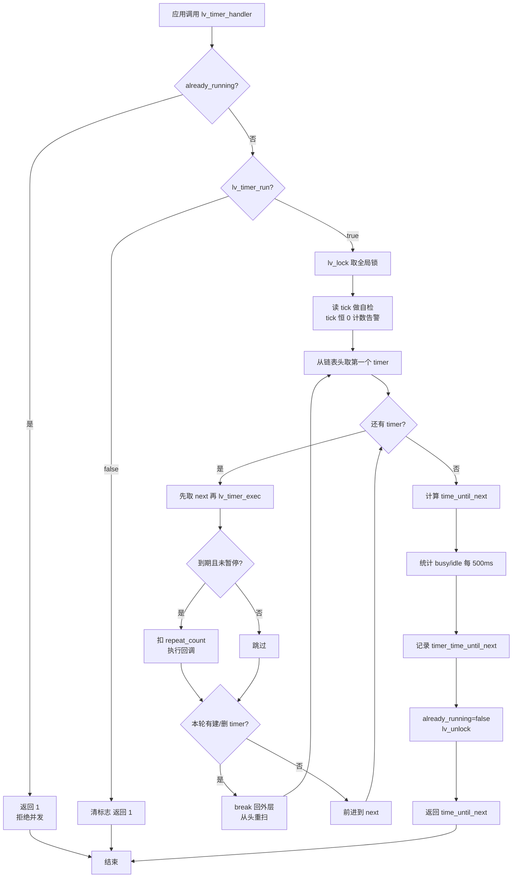
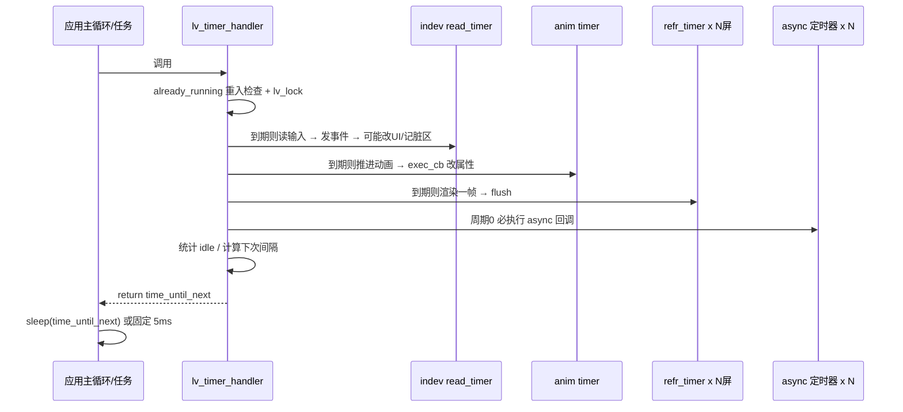
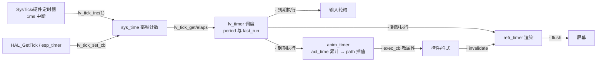

# LVGL 源码详解 06：定时器与任务模型——lv_timer / lv_anim / lv_async 三件套

> 涉及文件：
> - `src/misc/lv_timer.c`（426 行，心跳与调度）
> - `src/misc/lv_anim.c`（887 行，动画引擎）
> - `src/misc/lv_async.c`（111 行，异步调用）
> - `src/misc/lv_anim_timeline.c`（动画时间线）
> - `src/tick/lv_tick.c`（112 行，毫秒时基）
> - `src/osal/lv_freertos.c` 等（OS 集成时的线程/锁，见 07 篇）

> 配套速查：KB 条目 [lv_timer.md](../../../05-学习笔记与知识库/Knowledge-Base/lvgl/lv_timer.md)

---

## 1. 一切皆定时器：LVGL 的"任务模型"

LVGL 没有"任务"概念，全部并发单位收敛为一个**单线程定时器循环**：

| 内建定时器 | 周期 | 回调 | 创建处 |
|---|---|---|---|
| indev read_timer | 33 ms | `lv_indev_read_timer_cb` | lv_indev.c:111 |
| anim timer | 33 ms | `anim_timer` | lv_anim.c:67 |
| 每个 display 的 refr_timer | 33 ms | `lv_display_refr_timer` | lv_display.c:131 |
| async 一次性定时器 | 0 ms | `lv_async_timer_cb` | lv_async.c |
| 用户定时器 | 自定义 | 任意 | `lv_timer_create` |

它们共享一条**双向链表**（`timer_ll`，lv_timer.c:62 初始化），
由 `lv_timer_handler()` 统一驱动。理解了这一条链，就理解了 LVGL 的全部时序。

## 2. lv_timer_handler：心跳实现（lv_timer.c:68-143）

```c
LV_ATTRIBUTE_TIMER_HANDLER uint32_t lv_timer_handler(void)
{
    lv_timer_state_t * state_p = &state;
    /*Avoid concurrent running of the timer handler*/
    if(state_p->already_running) {                     /* :74 重入保护 */
        LV_TRACE_TIMER("already running, concurrent calls are not allow, returning");
        return 1;
    }
    state_p->already_running = true;

    if(state_p->lv_timer_run == false) {               /* :80 lv_timer_enable(false) 时直接返回 */
        state_p->already_running = false;
        return 1;
    }

    lv_lock();                                         /* :86 OS 模式下取全局锁 */

    uint32_t handler_start = lv_tick_get();

    if(handler_start == 0) {                           /* :90 tick 没接好的检测 */
        state.run_cnt++;
        if(state.run_cnt > 100) {
            state.run_cnt = 0;
            LV_LOG_WARN("It seems lv_tick_inc() is not called.");
        }
    }

    /*Run all timer from the list*/
    lv_timer_t * next;
    lv_timer_t * timer_active;
    lv_ll_t * timer_head = timer_ll_p;
    do {
        state_p->timer_deleted             = false;
        state_p->timer_created             = false;

        timer_active = lv_ll_get_head(timer_head);
        while(timer_active) {
            /*The timer might be deleted if it runs only once ('repeat_count = 1')
             *So get next element until the current is surely valid*/
            next = lv_ll_get_next(timer_head, timer_active);   /* :110 先取 next 再执行 */

            if(lv_timer_exec(timer_active)) {
                /*If a timer was created or deleted then this or the next item might be corrupted*/
                if(state_p->timer_created || state_p->timer_deleted) {
                    LV_TRACE_TIMER("Start from the first timer again because a timer was created or deleted");  /* :115 */
                    break;
                }
            }
            timer_active = next;
        }
    } while(timer_active);                             /* :122 链表被改过就从头再来一轮 */

    uint32_t time_until_next = lv_timer_get_time_to_next();   /* :124 */
    ...
    state_p->timer_time_until_next = time_until_next;
    state_p->already_running = false;
    LV_TRACE_TIMER(...);
    lv_unlock();
    return time_until_next;                            /* :142 返回下次间隔 */
}
```

四个关键机制：

1. **重入保护**（74-78 行）：`already_running` 标志——两个任务同时调
   `lv_timer_handler` 时后到者立即返回 1。这就是"多任务下也别并发调它"的框架层兜底。
2. **链表修改自愈**（102-122 行）：回调里创建/删除定时器会破坏遍历游标，
   框架用 `timer_created/timer_deleted` 标志发现异常、**从头重新遍历**。
   最坏情况是回调里频繁建删定时器导致 O(n²)，正常应用无感。
3. **返回值即"下次到期毫秒数"**（124 行 + 142 行）：所有未暂停定时器的
   `period - elapsed` 最小值（`lv_timer_get_time_to_next`，145-161 行）。
   主循环用它做自适应睡眠：`osDelay(LV_MIN(lv_timer_handler(), 33))` 类写法可省电。
4. **空闲率统计**（126-133 行）：每 500 ms（`IDLE_MEAS_PERIOD`，26 行）
   统计一次 busy/total，`lv_timer_get_idle()` 返回 0~100——性能监控与
   "CPU 够不够"的自检依据。

### 2.1 单个定时器的执行：lv_timer_exec（349-394 行）

```c
static bool lv_timer_exec(lv_timer_t * timer)
{
    if(timer->paused) return false;

    bool exec = false;
    if(lv_timer_time_remaining(timer) == 0) {
        /* Decrement the repeat count before executing the timer_cb. ...*/
        int32_t original_repeat_count = timer->repeat_count;
        if(timer->repeat_count > 0) timer->repeat_count--;      /* :359 先扣次数 */
        timer->last_run = lv_tick_get();                        /* :360 刷新时间戳 */

        if(timer->timer_cb && original_repeat_count != 0) {
            timer->timer_cb(timer);                             /* :365 执行回调 */
        }
        ...
        exec = true;
    }

    if(state.timer_deleted == false) {
        if(timer->repeat_count == 0) {  /*The repeat count is over, delete the timer*/
            if(timer->auto_delete) {
                lv_timer_delete(timer);                          /* :384 次数用尽自动删 */
            }
            else {
                lv_timer_pause(timer);                           /* :388 或自动暂停 */
            }
        }
    }
    return exec;
}
```

`repeat_count = -1` 表示无限（创建时的默认，lv_timer.c:188）。
`lv_timer_ready(timer)`（247-252 行）把 `last_run` 倒拨
`tick - period - 1`，下次 handler 一进就执行——**"立即跑一次"的正规姿势**。

### 2.2 创建：头插与 resume 通知

```c
lv_timer_t * lv_timer_create(lv_timer_cb_t timer_xcb, uint32_t period, void * user_data)
{
    new_timer = lv_ll_ins_head(timer_ll_p);            /* :182 新定时器插到链表头 */
    ...
    new_timer->period = period;
    new_timer->timer_cb = timer_xcb;
    new_timer->repeat_count = -1;
    new_timer->last_run = lv_tick_get();
    new_timer->auto_delete = true;
    ...
    state.timer_created = true;
    lv_timer_handler_resume();                         /* :200 通知外部调度器 */
}
```

两个细节：
- **头插**意味着后建的定时器先执行（同周期时顺序可预期：新的先跑）。
- `lv_timer_handler_resume`（413-420 行）把 `timer_time_until_next` 清零并调
  用户注册的 `resume_cb`（`lv_timer_handler_set_resume_cb`，422 行）——
  RTOS 集成时用它唤醒挂起的 LVGL 任务（见 07 篇 FreeRTOS 部分）。

## 3. lv_anim：run_round 技巧驱动的动画引擎

### 3.1 动画描述符与默认值（lv_anim_init，102-116 行）

| 字段 | 默认 | 含义 |
|---|---|---|
| duration | 500 ms | 单程时长 |
| start/end_value | 0 → 100 | 值域 |
| repeat_cnt | 1 | 重复次数（`LV_ANIM_REPEAT_INFINITE` 无限） |
| path_cb | linear | 插值路径（ease_in/out、overshoot、bounce…） |
| early_apply | 1 | start 时立刻应用起始值（先移过去再动画） |
| exec_cb | — | 每帧回调 `exec_cb(var, value)` |

### 3.2 启动（lv_anim_start，118-166 行）

```c
    /*Do not let two animations for the same 'var' with the same 'exec_cb'*/
    if(a->early_apply && (a->exec_cb || a->custom_exec_cb)) {
        remove_concurrent_anims(a);                    /* :124-126 同变量同回调的旧动画先删 */
    }
    lv_anim_t * new_anim = lv_ll_ins_head(anim_ll_p);  /* :129 头插 */
    ...
    new_anim->run_round = state.anim_run_round;        /* :136 记下本轮计数 */
    if(new_anim->early_apply) {
        ...
        resolve_time(new_anim);
        new_anim->current_value = new_anim->path_cb(new_anim);   /* :151 */
        if(new_anim->exec_cb) new_anim->exec_cb(new_anim->var, new_anim->current_value);  /* :153 立即应用 */
    }
    anim_mark_list_change();
```

`remove_concurrent_anims` 是"同一控件同一属性只保留最新动画"的来源——
`lv_obj_set_x` 的动画语义天然如此（新动画顶掉旧的）。

### 3.3 驱动：anim_timer（611-702 行）

```c
static void anim_timer(lv_timer_t * param)
{
    /*Flip the run round*/
    state.anim_run_round = state.anim_run_round ? false : true;    /* :616 每轮翻转全局奇偶 */

    lv_anim_t * a = lv_ll_get_head(anim_ll_p);
    while(a != NULL) {
        uint32_t elaps = lv_tick_elaps(a->last_timer_run);
        ...
        else {
            a->act_time += elaps;                                  /* :634 累计已播时间 */
        }
        a->last_timer_run = lv_tick_get();
        state.anim_list_changed = false;
        ...
        if(!a->is_paused && a->run_round != state.anim_run_round) {  /* :644 本轮没跑过的才跑 */
            a->run_round = state.anim_run_round;
            ...
            if(a->act_time >= 0) {
                int32_t act_time_original = a->act_time;
                if(a->act_time > a->duration) a->act_time = a->duration;
                ...
                int32_t new_value;
                new_value = a->path_cb(a);                         /* :670 插值 */
                if(new_value != a->current_value) {
                    a->current_value = new_value;
                    if(a->exec_cb) a->exec_cb(a->var, new_value);  /* :675 应用 */
                }
                ...
                if(a->act_time >= a->duration) {
                    anim_completed_handler(a);                     /* :688 完成处理 */
                }
            }
        }
        /*If the linked list changed due to anim. delete then it's not safe to continue ...*/
        if(state.anim_list_changed)
            a = lv_ll_get_head(anim_ll_p);                         /* :697 从头重扫 */
        else
            a = lv_ll_get_next(anim_ll_p, a);
    }
}
```

**run_round 技巧**：全局奇偶每轮翻转，动画记录自己"上次跑在哪一奇偶"。
一轮内新插入的动画（run_round 已等于本轮值）不会立即执行——
它自然等到下一轮，避免"刚创建就跑满帧"的时序毛刺。

完成处理 `anim_completed_handler`（709-762 行）：
`repeat_cnt--` → 删除并回调 `completed_cb/deleted_cb`（719-737 行）；
未完则重置 `act_time`（多播的超出时间补偿进下一轮，743 行），
reverse 模式交换起止值与时长（746-760 行）。

动画定时器的**自动暂停**：列表为空时把 anim timer 暂停
（`anim_mark_list_change`，770-780 行）——没有动画时零开销；
`lv_anim_start` 再启用。同理 `lv_anim_enable_vsync_mode(true)`（78-100 行）
删除周期定时器，改由 display 的 VSYNC 事件驱动（每帧同步推进）。

### 3.4 动画与控件生命周期的绑定

`lv_anim_delete(obj, NULL)`（183-204 行）按 var 删全部动画——
析构函数就靠它清场（lv_obj.c:1541）。样式过渡动画挂在
`style_trans_ll`（lv_obj_style.c:107-110），删除走同一条 anim 机制。

## 4. lv_async：0 周期一次性定时器

```c
lv_result_t lv_async_call(lv_async_cb_t async_xcb, void * user_data)
{
    lv_async_info_t * info = lv_malloc(sizeof(lv_async_info_t));
    if(info == NULL) return LV_RESULT_INVALID;

    /*Create a new timer*/
    lv_timer_t * timer = lv_timer_create(lv_async_timer_cb, 0, info);   /* period=0 */
    if(timer == NULL) {
        lv_free(info);
        return LV_RESULT_INVALID;
    }

    info->cb = async_xcb;
    info->user_data = user_data;
    lv_timer_set_repeat_count(timer, 1);                                /* 只跑一次 */
    return LV_RESULT_OK;
}
```

回调侧（lv_async.c:107-115）**先删定时器再执行用户回调**：

```c
static void lv_async_timer_cb(lv_timer_t * timer)
{
    /*Save the info because an lv_async_call_cancel might delete it in the callback*/
    lv_async_info_t * info = (lv_async_info_t *)timer->user_data;
    lv_async_info_t info_save = *info;
    lv_timer_delete(timer);
    lv_free(info);

    info_save.cb(info_save.user_data);
}
```

用途："在当前调用栈之外再执行"——例如在 `LV_EVENT_DRAW_*` 里不能改布局，
就用 `lv_async_call` 推迟到本帧事件处理完之后的定时器轮次。
`period = 0` 意味着 `lv_timer_time_remaining` 恒 0（elapsed>=period），
**下一次 lv_timer_handler 必执行**。取消用 `lv_async_call_cancel`
（66-96 行，遍历定时器链按 cb+user_data 匹配删除）。

## 5. 时基：lv_tick.c

```c
LV_ATTRIBUTE_TICK_INC void lv_tick_inc(uint32_t tick_period)
{
    state_p->sys_irq_flag = 0;                     /* :41 */
    state_p->sys_time += tick_period;              /* :42 */
}

uint32_t lv_tick_get(void)
{
    lv_tick_state_t * state_p = &state;
    if(state_p->tick_get_cb) return state_p->tick_get_cb();   /* :49 推荐方式：直接读硬件毫秒计数 */

    /*If `lv_tick_inc` is called from an interrupt while `sys_time` is read ...*/
    uint32_t result;
    do {
        state_p->sys_irq_flag = 1;
        result        = state_p->sys_time;
    } while(!state_p->sys_irq_flag);               /* :58-61 被中断打断就重读 */

    return result;
}
```

两种接法（二选一）：

| 方式 | 接法 | 适合 |
|---|---|---|
| `lv_tick_inc(1)` | RTOS tick hook 里每 1 ms 调 | SysTick 驱动的 MCU |
| `lv_tick_set_cb(my_millis)` | 直接提供读毫秒函数 | 已有 HAL_GetTick / esp_timer 时更省事 |

v10 推荐 set_cb 方式（无中断竞态、无重读循环）。
`lv_tick_elaps(prev)`/`lv_tick_diff`（66-75 行）利用**无符号回绕**计算
时间差——32 位毫秒计数 49.7 天回绕也不会算错。
`lv_delay_ms`（77-93 行）无 delay_cb 时忙等（裸机），RTOS 下接 osDelay。

## 6. 一次 lv_timer_handler 的完整时序

### 6.1 执行流



### 6.2 时序图



新定时器头插 → 同一轮循环里"后创建的先执行"。indev/anim/refr 的相对顺序
取决于创建顺序：`lv_init` 先建 anim timer（lv_anim.c:67，init 阶段 206 行），
display 创建时再建 refr_timer（lv_display.c:131），indev 更晚（lv_indev.c:111）。
所以一轮里通常是 **anim → refr → indev → async** 的先来后到。

## 7. 时间从哪来（数据流）



## 8. 陷阱与实测建议

1. **`lv_timer_handler` 返回值别丢**：1 表示"没干活/被跳过"，
   正常值是下次间隔 ms；`LV_NO_TIMER_READY`（无定时器可跑）时也返回
   `time_until_next` 的哨兵值——轮询式主循环固定 `sleep(5)` 即可，
   自适应循环 `sleep(min(ret, 33))` 更省电。
2. **回调里删自己没问题，删别的定时器也会自愈**（102-122 行从头重扫），
   但**回调里 `lv_timer_enable(false)` 会让本轮剩余定时器全部跳过**
   （80-83 行在锁内检查）。
3. **动画完成回调里 `lv_anim_start` 新动画是允许的**：`anim_list_changed`
   标志让循环从头重扫（697 行），但注意新动画若同 var 同 cb 会顶掉
   自己刚完成的那个（remove_concurrent_anims）。
4. **`repeat_cnt = 0` 的定时器根本不会执行**：exec 前置检查
   `original_repeat_count != 0`（lv_timer.c:363）——想只跑一次设 1
   （async 就是这么用的）。
5. **tick 未接通的诊断信号**：日志刷屏 "It seems lv_tick_inc() is not called."
   （lv_timer.c:94），且所有动画/刷新停滞；先查 tick hook 或 set_cb。
6. **`lv_timer_pause(refr_timer)` 手动调用后要记得 resume**：框架在
   渲染中会自暂停（lv_refr.c:396），若你在回调外也停了它，
   下一次 invalidate 后需要 `lv_timer_resume` 恢复节拍（或开 perf monitor
   让框架保持常转）。
7. **`lv_async_call` 的回调执行时机是"下一次 handler 循环"**，不是
   "本轮末尾"；周期为 0 但如果 handler 正在跑（重入保护），
   会顺延到下一次进入。同一轮内多个 async 按创建序头插先执行。
