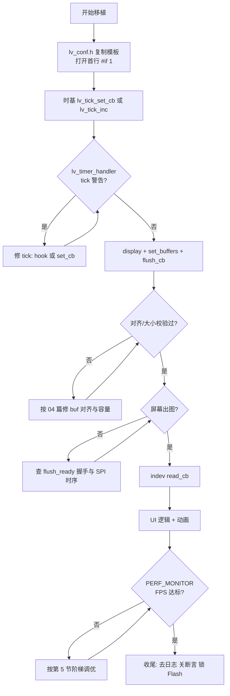
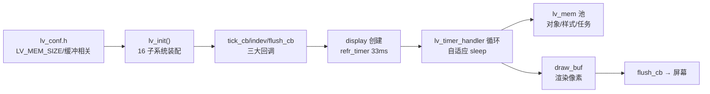

# LVGL 源码详解 07：移植与实战指南——lv_conf.h / FreeRTOS / 坑清单

> 涉及文件：
> - `lv_conf_template.h`（2640 行，全库配置模板）
> - `src/lv_init.c`（初始化顺序）
> - `src/osal/lv_freertos.c`（572 行，FreeRTOS 适配实现）
> - `src/osal/lv_os_none.c`（裸机空实现）
> - `src/stdlib/lv_mem.c`（191 行，内存抽象）
> - `README.md:203-271`（最小移植示例）

---

## 1. 移植五步法（最小可跑）

README.md:234-270 官方骨架，等价的五步：

```c
/* 1. 初始化库 */
lv_init();

/* 2. 接时基（二选一） */
lv_tick_set_cb(my_get_millisec);          /* 推荐：直接给毫秒函数 */
/* 或 RTOS tick hook 里：lv_tick_inc(1); */

/* 3. 创建显示器 */
lv_display_t * disp = lv_display_create(320, 240);

/* 4. 配缓冲 + flush 回调 */
static uint8_t buf[320 * 240 / 10 * 2];   /* 1/10 屏，RGB565 */
lv_display_set_buffers(disp, buf, NULL, sizeof(buf), LV_DISPLAY_RENDER_MODE_PARTIAL);
lv_display_set_flush_cb(disp, my_flush_cb);

/* 5. 输入设备（可选） */
lv_indev_t * indev = lv_indev_create();
lv_indev_set_type(indev, LV_INDEV_TYPE_POINTER);
lv_indev_set_read_cb(indev, my_touch_read_cb);

/* 主循环 */
while(1) { lv_timer_handler(); sleep_ms(5); }
```

每一步背后的机制见 04/05/06 篇。顺序错误（先建对象后 lv_init、先 flush 后
set_buffers）都会在日志里以 NULL 指针告警或直接断言。

## 2. lv_conf.h 关键配置逐项表

从 `lv_conf_template.h` 摘录高频配置（行号为模板中的位置）：

### 2.1 内存（模板 37-67 行）

| 宏 | 行号 | 默认 | 说明 |
|---|---|---|---|
| `LV_USE_STDLIB_MALLOC` | 37 | `LV_STDLIB_BUILTIN` | 内置池 / CLIB malloc / MICROPYTHON / RTTHREAD / 自定义 |
| `LV_MEM_SIZE` | 59 | 64 KB (65536) | 内置内存池大小，**至少 2048**；控件树+样式+任务全在这 |
| `LV_MEM_ADR` | 64 | 0 | 把池放到固定地址（0x0=跟随普通数组放置） |
| `LV_USE_STDLIB_STRING/SPRINTF` | 46/55 | BUILTIN | 字符串/格式化用内置省 libc |

**内存账**：64 KB 池的典型去向——对象 52 B/个（01 篇）+ spec_attr + 样式 +
每帧绘制任务（几百 B/个）+ 图像缓存（`LV_CACHE_DEF_SIZE`，lv_conf_template.h:892，
默认 0=禁用解码图像缓存）。多图片 UI 建议改 `LV_USE_STDLIB_MALLOC=CLIB`
把压力转给系统堆，或加大 LV_MEM_SIZE。

### 2.2 时序（148-158 行）

| 宏 | 行号 | 默认 | 说明 |
|---|---|---|---|
| `LV_DEF_REFR_PERIOD` | 153 | 33 ms | 刷新/输入/动画三者的统一节拍（≈30 FPS） |
| `LV_DPI_DEF` | 156 | 130 | 逻辑 DPI，影响默认控件尺寸与 LV_DPX() 缩放 |

### 2.3 渲染缓冲与绘制（152-330 行）

| 宏 | 行号 | 默认 | 说明 |
|---|---|---|---|
| `LV_DRAW_BUF_STRIDE_ALIGN` | 159 | 1 | 行对齐字节；DMA 要求对齐时改 4/16/32 |
| `LV_DRAW_LAYER_SIMPLE_BUF_SIZE` | 180 | 24576 B | 离屏 layer 的行块预算（02 篇 lv_obj_refr） |
| `LV_DRAW_SW_DRAW_UNIT_CNT` | 271 | 1 | 软件渲染线程数；**>1 必须有 OS** |
| `LV_DRAW_THREAD_STACK_SIZE` | 190 | 8192 B | 渲染线程栈 |
| `LV_DRAW_THREAD_PRIO` | 203 | 3 | 渲染线程优先级 |
| `LV_USE_DRAW_SW` | 227 | 1 | 软件渲染总开关 |
| `LV_DRAW_SW_COMPLEX` | 284 | 1 | 阴影/圆角 mask/任意混合（关掉显著省 Flash 但降效果） |
| `LV_DRAW_SW_SHADOW_CACHE_SIZE` | 296 | 0 | 阴影缓存条目大小；阴影重的 UI 建议开 |
| `LV_USE_DRAW_SW_ASM` | 314 | NONE | NEON / HELIUM / RISCV_V / SVE2 / CUSTOM SIMD |
| GPU 系列 | 327-667 | 0 | `LV_USE_DRAW_VG_LITE / DMA2D / PXP / DAVE2D / G2D / OPENGLES / NANOVG / SDL / EVE` |

**双核 MCU 推荐组合**：`LV_DRAW_SW_DRAW_UNIT_CNT=2` + `LV_USE_OS=LV_OS_FREERTOS`，
配 02 篇的 tile 切片并行。

### 2.4 OS 集成（96-107 行）

| 宏 | 值域 |
|---|---|
| `LV_USE_OS` | `LV_OS_NONE`（默认）/ `LV_OS_PTHREAD` / `LV_OS_FREERTOS` / `LV_OS_CMSIS_RTOS2` / `LV_OS_RTTHREAD` / `LV_OS_WINDOWS` / `LV_OS_MQX` / `LV_OS_SDL2` / `LV_OS_CUSTOM` |

### 2.5 输入手感（672-700 行）

| 宏 | 行号 | 默认 |
|---|---|---|
| `LV_INDEV_DEF_SCROLL_LIMIT` | 676 | 10 px |
| `LV_INDEV_DEF_SCROLL_THROW` | 679 | 10 |
| `LV_INDEV_DEF_LONG_PRESS_TIME` | 685 | 400 ms |
| `LV_INDEV_DEF_LONG_PRESS_REP_TIME` | ~688 | 300 ms |
| `LV_INDEV_DEF_DOUBLE_CLICK_TIME` | ~691 | 300 ms |
| `LV_INDEV_DEF_GESTURE_LIMIT` | 694 | 50 px |
| `LV_INDEV_DEF_GESTURE_MIN_VELOCITY` | ~697 | 3 |

### 2.6 字体与主题（845-1200 行）

| 宏 | 行号 | 默认 | 说明 |
|---|---|---|---|
| `LV_THEME_DEFAULT_DARK` | 855 | 0 | 深色主题 |
| `LV_THEME_DEFAULT_TRANSITION_TIME` | 861 | 80 ms | 主题状态过渡时长；0 关闭过渡省 CPU |
| `LV_FONT_DEFAULT` | 1147 | Montserrat 14 | 换成自己的字体（含中文子集） |
| `LV_USE_FONT_COMPRESSED` | 1158 | 0 | 支持压缩字形（省 Flash 换 CPU） |
| `LV_USE_FREETYPE` | 1180 | 0 | 动态 TTF 渲染（大，慎用 MCU） |

**中文显示**：内置字体无汉字。用 lv_font_conv 生成含所需汉字的 C 数组
（或 binfont），`LV_FONT_DEFAULT` 指过去即可；UTF-8 编码由 lv_init 自检
（lv_init.c:287-293）兜底。

### 2.7 调试与监控（790-820 / 2090-2380 行）

| 宏 | 行号 | 默认 | 说明 |
|---|---|---|---|
| `LV_USE_LOG` | 793 | 0 | 日志总开关 |
| `LV_LOG_LEVEL` | 805 | WARN | TRACE 级会明显拖慢（lv_init.c:320-322 有告警） |
| `LV_USE_PERF_MONITOR` | 2096 | 0 | 屏上 FPS/CPU 实时贴片 |
| `LV_USE_PERF_MONITOR_POS` | 2111 | BOTTOM_RIGHT | 贴片位置 |
| `LV_USE_MEM_MONITOR` | 2120 | 0 | 内存贴片 |
| `LV_USE_ASSERT*` 系列 | 2362-2377 | 0 | 断言开关（MALLOC/NULL/STYLE/MEM_INTEGRITY/OBJ） |
| `LV_USE_OBJ_STYLE_CACHE` | 734 | 1 | 样式位图缓存，保持 1 |

## 3. FreeRTOS 集成要点

### 3.1 选择 `LV_USE_OS = LV_OS_FREERTOS` 后得到什么

`src/osal/lv_freertos.c`（572 行）提供：

| 原语 | 实现 | 行号 |
|---|---|---|
| `lv_lock/lv_unlock` | FreeRTOS 递归互斥量 `xSemaphoreCreateRecursiveMutex` | 447-451 |
| `lv_thread_sync_*` | 计数信号量 + 互斥量实现的条件同步 | 487-499 |
| `lv_thread_init` | `xTaskCreate` 包装（渲染线程用它） | — |
| `lv_os_get_idle_percent` | 空闲率查询 | 409 |

### 3.2 任务结构推荐

```
LvTask（优先级中低，栈 ≥ 16 KB）:
    while(1) {
        uint32_t wait = lv_timer_handler();
        vTaskDelay(pdMS_TO_TICKS(LV_MAX(wait, 5)));   /* 自适应延时 */
    }
```

- **所有 LVGL API 只在 LvTask 上下文调用**。其他任务传数据用队列/
  observer（`LV_USE_OBSERVER` 的 lv_subject）转发给 LvTask。
- `lv_timer_handler` 内部 `lv_lock()`（lv_timer.c:86）：若另一个任务
  短暂持有锁（如 `lv_lock(){ lv_obj_set_pos(...); } lv_unlock()`），
  handler 会阻塞等待，逻辑安全——但临界段要短。
- **渲染线程**：`LV_DRAW_SW_DRAW_UNIT_CNT>1` 时由 `lv_draw_sw_init`
  创建（lv_draw_sw.c:111-122），栈 `LV_DRAW_THREAD_STACK_SIZE=8192 B`
  来自 FreeRTOS 堆；记得给 FreeRTOS 堆留余量。
- **tick**：`vApplicationTickHook` 里 `lv_tick_inc(1)`，或直接
  `lv_tick_set_cb(xTaskGetTickCount 换算)`。注意 tick hook 是中断上下文。
- **堆预算**：LvTask 栈 16 KB + 渲染线程栈 8 KB/线程 + LVGL 池 64 KB
  全部吃 RTOS 内存；启动后用 `xPortGetFreeHeapSize` 打印余量核对。

### 3.3 resume_cb：让 handler 自己醒来

`lv_timer_handler_set_resume_cb`（lv_timer.c:422-426）：当新定时器就绪时
框架会调它。RTOS 任务里可以注册"give 信号量"——这样任务用
`ulTaskNotifyTake` 睡眠，事件驱动唤醒，省去 5 ms 轮询空转。

## 4. 常见坑清单（按出现频率排序）

| # | 症状 | 根因 | 出处 |
|---|---|---|---|
| 1 | 屏幕全白/全黑但日志正常 | flush_cb 没调 flush_ready，或缓冲没 set_buffers | lv_display.c:756 |
| 2 | "It seems lv_tick_inc() is not called." 刷屏 | tick 没接 | lv_timer.c:94 |
| 3 | 断言 "Invalidate area is not allowed during rendering" | 多任务改 UI / DRAW 事件里改样式 | lv_refr.c:289 |
| 4 | 中文乱码 | 源文件非 UTF-8 或字体无汉字 | lv_init.c:287-293 |
| 5 | 启动断言 big/little endian | `LV_BIG_ENDIAN_SYSTEM` 配反 | lv_init.c:295-306 |
| 6 | "No display created yet." | lv_init 前/无 display 时创建对象 | lv_obj_class.c:62 |
| 7 | buf1 is not properly aligned | 缓冲地址不满足 LV_DRAW_BUF_ALIGN | lv_display.c:559 |
| 8 | mode requires screen sized buffer(s) | FULL/DIRECT 用了小缓冲 | lv_display.c:575 |
| 9 | 偶发花屏（PARTIAL） | flush 异步但没等 DMA 完成就复用缓冲 | flush_ready 时序，04 篇 |
| 10 | 多任务偶发死机 | 在 ISR/其他任务调 LVGL API | 单线程规则，00 篇 |

## 5. 性能调优阶梯（从便宜到贵）

1. **量先于调**：`LV_USE_PERF_MONITOR=1` 看三数——FPS / CPU（=1-idle，
   来自 lv_timer.c:126-133 的统计）/ 帧时间。
2. **控脏区**：全屏动画（背景动）最贵；避免无意义 `lv_obj_invalidate(screen)`；
   大列表滚动用快照层（widget 自带 layer_type）。
3. **缓冲模式升级**：PARTIAL 小缓冲 flush 次数多 → 加大缓冲到 1/4 屏；
   RAM 富余上 DIRECT 双缓冲（渲染/传输重叠 + 免整屏拷贝）。
4. **flush 异步化**：DMA + 完成中断里调 `lv_display_flush_ready`；
   SPI 拉到屏幕允许的最高时钟；检查是否每次 flush 都在重新设窗口。
5. **绘制单元**：双核开 `LV_DRAW_SW_DRAW_UNIT_CNT=2`（tile 并行）；
   有 GPU 的芯片开对应后端（DMA2D 填充/混合、PXP、vg_lite 矢量），
   注意 GPU 后端 `tile_cnt` 会被强制 1（lv_display.c:699-705）。
6. **关掉用不到的效果**：`LV_DRAW_SW_COMPLEX=0`（无阴影/特殊混合）、
   主题过渡时间设 0（lv_conf_template.h:861）、少用 `opa_layered`/旋转。
7. **SIMD**：M55/H7 上开 HELIUM/NEON（lv_conf_template.h:314）。
8. **编译级**：-O2、把 `src/draw/sw/blend/` 放 RAM（`LV_ATTRIBUTE_FAST_MEM`）。

## 6. 移植自检清单



数据落位核对（上屏链路）：



## 7. 一页速查：默认值与资源量

| 项 | 值 | 出处 |
|---|---|---|
| 刷新周期 | 33 ms（30 FPS） | lv_conf_template.h:153 |
| 脏区数组 | 32 块 | lv_display_private.h:30 |
| LVGL 内存池 | 64 KB | lv_conf_template.h:59 |
| 默认字体 | Montserrat 14 | lv_conf_template.h:1147 |
| 长按判定 | 400 ms | lv_conf_template.h:685 |
| 滚动触发 | 10 px | lv_conf_template.h:676 |
| 渲染线程栈 | 8 KB/线程 | lv_conf_template.h:190 |
| 离屏 layer 行块 | 24 KB | lv_conf_template.h:180 |
| 最小 RAM（官方口径） | 32 KB | README.md:68 |
| 最小 Flash | 128 KB | README.md:68 |

> 把这份表贴在工位上：排查任何"刷新怪问题"前，先确认这十个默认值
> 有没有被改过——八成的疑难杂症出在配置与缓冲模式，而不是库本身。
